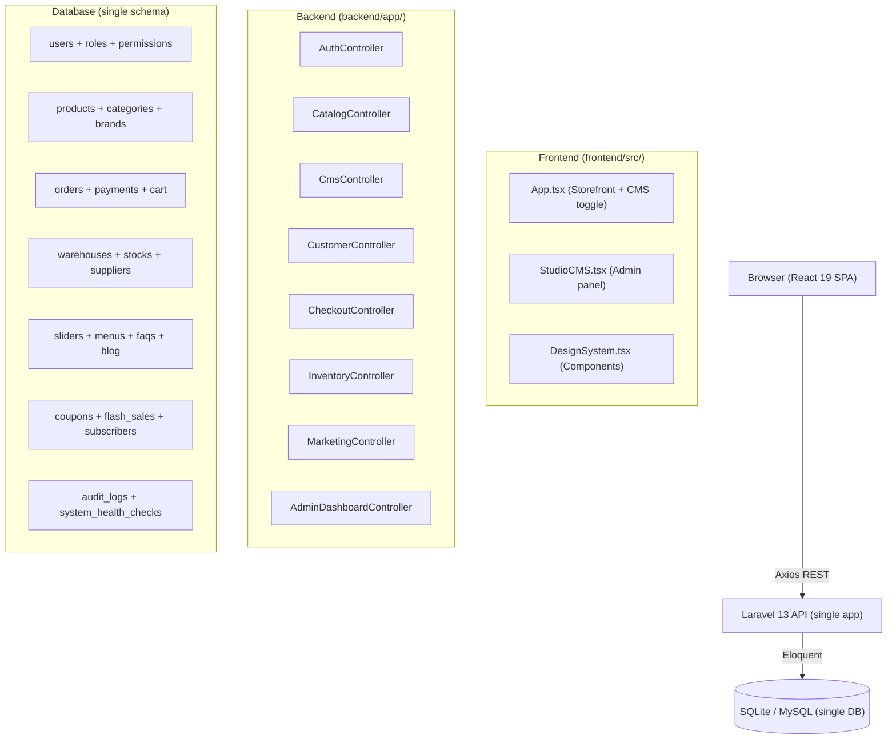
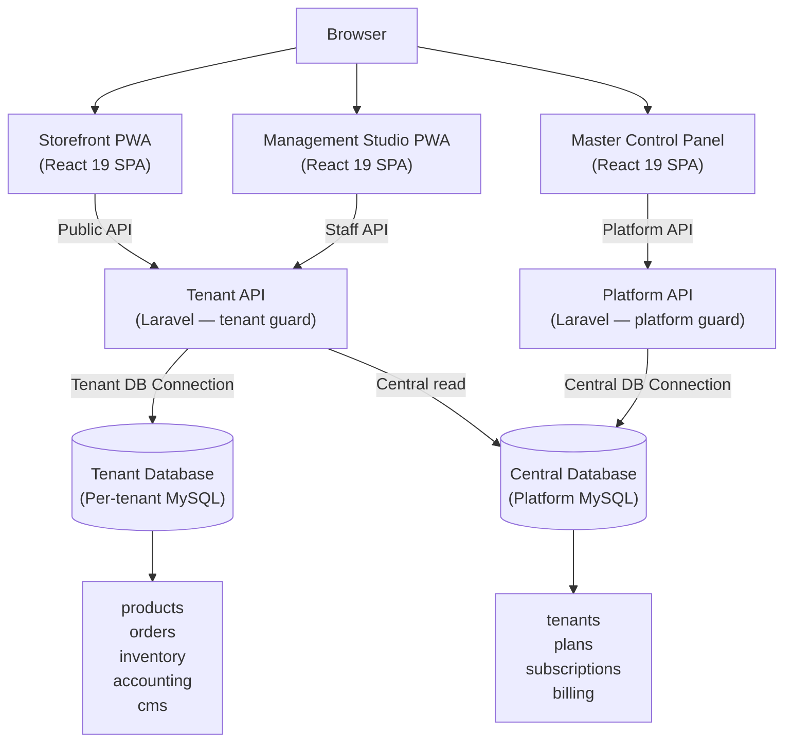
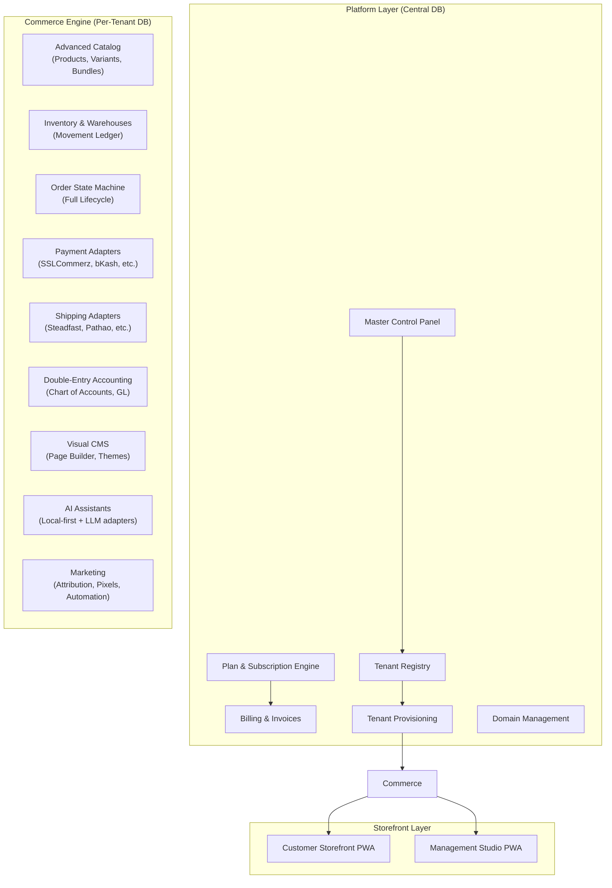
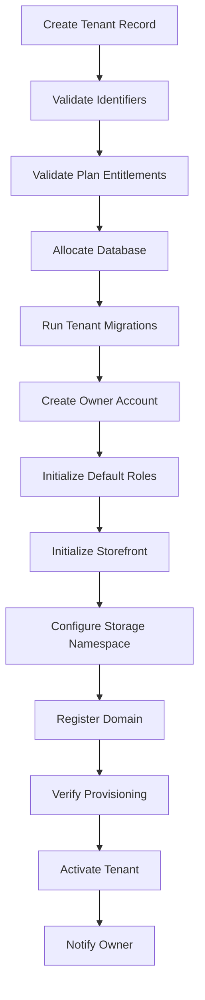

# 🏛️ CENTERPOINT — Flagship Commerce Platform
## Architectural Blueprint, Repository Audit & Governance Plan

> *"Before we touch a single line of code, let us understand the underlying state machine. The gap between what exists and what is required is vast — but every existing decision was made for a reason. We honor what works. We surgically replace what does not."*

---

## 1. 🎓 Conceptual Masterclass: Philosophy, First Principles & Landscape

### The Core Problem

E-commerce-PointOne is a well-structured **proof-of-concept monolith** — a luxury storefront with 26 seeded products, a rudimentary RBAC system, a basic cart/checkout, and a CMS admin panel built as a single-page toggle. It is not yet a production platform. The gap between the current state and CENTERPOINT's requirements spans approximately 10 architectural phases and hundreds of discrete capabilities.

The challenge is not technical complexity alone. The challenge is **preserving what works** while introducing:

1. **Dual-edition deployment** — the same codebase must support SaaS multi-tenancy AND fully independent standalone installations.
2. **Hybrid database architecture** — a central platform database (tenants, plans, billing) alongside isolated per-tenant operational databases.
3. **Financial-grade data integrity** — double-entry accounting, immutable transaction ledgers, and decimal-safe monetary calculations.
4. **Provider-independent integration architecture** — payments, shipping, AI, analytics, and marketing must be swappable adapters.
5. **A visual CMS with security isolation** — custom HTML/CSS/JS must never execute in the privileged admin origin.

### Theoretical Foundations

**Domain-Driven Design (DDD):** CENTERPOINT's complexity demands explicit bounded contexts. Commerce, Accounting, Inventory, Fulfillment, Marketing, CMS, Tenancy, and AI are distinct domains with separate aggregate roots. Business rules must not bleed across domain boundaries.

**Hexagonal Architecture (Ports & Adapters):** Every external integration — payment gateways, courier APIs, LLM providers, analytics platforms — must communicate through a defined port. No provider-specific code inside domain logic.

**Event-Driven State Machines:** Order lifecycle, inventory movements, and financial journal entries must follow deterministic state transitions. No arbitrary `UPDATE status = X` queries without validated state guards.

**Idempotency by Design:** Payments, shipment bookings, webhooks, and queued jobs must be idempotent. Infrastructure failures must not produce duplicate financial records or double-charged customers.

**Tenant Context as a First-Class Concern:** Every database query, cache read, file operation, queued job, and API call must carry verified tenant context. This is not middleware-optional — it is a security invariant.

### Comparative Precedents

| Problem | Battle-tested Solution | CENTERPOINT Application |
|---|---|---|
| Multi-tenancy isolation | PostgreSQL row-level security / Shopify's shard model | Separate MySQL databases per tenant, dynamically resolved |
| Immutable financial records | Traditional double-entry ledger / PostgreSQL append-only tables | Immutable `journal_entries` table, reversal entries for corrections |
| Payment webhook safety | Stripe's idempotency keys + Svix webhook delivery | Per-provider signature verification + idempotency key table |
| CMS custom JS isolation | Shopify's App Proxy + sandboxed liquid / Squarespace iframe isolation | Sandboxed iframe with strict CSP for custom tenant code |
| Inventory concurrency | PostgreSQL advisory locks / Redis SETNX | MySQL `SELECT FOR UPDATE`, pessimistic locking during checkout |

### Technology Stack Confirmed (Existing + Target)

**Backend (Existing — Preserve):**
- Laravel 13.x (Framework)
- PHP 8.3+
- Laravel Sanctum 4.x
- MySQL (production) / SQLite (dev/test)
- Database-backed queues (cPanel-compatible fallback)
- Custom `HasRoles` RBAC trait (functional, needs expansion)

**Frontend (Existing — Preserve & Extend):**
- React 19 + TypeScript
- Vite 8.x + TailwindCSS v4
- TanStack Query v5
- React Router DOM v7
- Framer Motion v12
- Lucide React v1
- React Hook Form + Zod v4
- react-hot-toast
- Chart.js + react-chartjs-2
- i18next + react-i18next

**Missing Dependencies (To Add):**
- `stancl/tenancy` (Tenancy for Laravel) — hybrid tenant database management
- `brick/money` — decimal-safe monetary calculations
- `spatie/laravel-data` — typed data transfer objects
- `spatie/laravel-medialibrary` — media management with tenant namespacing
- `spatie/laravel-activitylog` — audit trail
- `league/fractal` or Laravel API Resources (extend existing pattern)
- `Zustand` — lightweight client state for management studio
- `@dnd-kit/core` — drag-and-drop for CMS page builder
- `recharts` or `ApexCharts` — replace Chart.js for richer analytics
- `workbox-window` — PWA service worker management
- `react-pdf` — invoice PDF rendering

---

## 2. 🔍 Surgical Critique & Red Teaming (What Could Break?)

### Critical Security Vulnerabilities in Current Code

**[CRITICAL] No backend authorization checks on "admin" routes:**
```php
// api.php — Line 56-70
Route::middleware('auth:sanctum')->group(function () {
    // ANY authenticated user (including customers) can access:
    Route::get('/admin/analytics', [AdminDashboardController::class, 'analytics']);
    Route::get('/admin/logs', [AdminDashboardController::class, 'logs']);
    Route::get('/admin/health', [AdminDashboardController::class, 'health']);
    // Also: inventory, suppliers, purchase orders
});
```
A customer who logs in can access admin analytics, audit logs, and all inventory management endpoints. This is a broken access control vulnerability (OWASP A01).

**[CRITICAL] Payment service simulates success by default:**
```php
// PaymentService.php — Line 20
$status = match($method) {
    'cod' => 'pending',
    'wallet' => $this->deductWallet($order),
    default => 'completed',  // ← Any unknown method is "completed"
};
```
Any non-COD, non-wallet payment method returns `completed` without verification. Fake payment methods will create "paid" orders.

**[CRITICAL] Health check hardcodes service statuses as 'ok':**
```php
// AdminDashboardController.php
'redis' => 'ok',   // ← Redis is never actually checked
'storage' => 'ok', // ← Storage is never actually checked
'mail' => 'ok',    // ← Mail is never actually checked
```

**[HIGH] Cart is session/user-based but checkout doesn't verify stock:**
The `CheckoutController` (inferred from routes) must be inspected to confirm whether backend stock validation occurs before order placement. Frontend-only validation is insufficient.

**[HIGH] RBAC check uses loaded relationship, not database:**
```php
// HasRoles trait — hasRole()
return $this->roles->contains('name', $role);
// If roles are not eager-loaded, this returns empty collection (always false).
```

**[HIGH] Seeder truncates with PRAGMA for SQLite only:**
```php
DB::statement('PRAGMA foreign_keys = OFF;');
```
This seeder will fail or behave incorrectly when migrating to MySQL production.

**[MEDIUM] Admin authentication is a single shared user pool:**
Customers and admins share the same `users` table with no structural separation. The "isAdmin" check is entirely role-based. There is no separate admin guard.

**[MEDIUM] Cart total_amount is stored (denormalized) but not recalculated on checkout:**
Trusting stored totals risks price manipulation if product prices change between cart creation and checkout.

**[MEDIUM] No CSRF protection on SPA:**
SPA with Sanctum token auth bypasses CSRF by design, but stateful web routes need explicit review.

### Fragile Assumptions

1. **Assumption:** The existing single database will simply become "tenant database." **Reality:** The tenancy architecture requires a *separate* central database for platform data and per-tenant databases for operational data. The current migrations create everything in one schema.

2. **Assumption:** The existing `users` table can accommodate platform admins, tenant staff, and customers simultaneously. **Reality:** These are fundamentally different identity types with different authentication guards, different permission systems, and different data isolation requirements.

3. **Assumption:** The existing cart uses sessions safely. **Reality:** Session-based carts work for single-tenant deployments but require tenant-aware cache keys in multi-tenant mode to prevent cross-tenant cart leakage.

4. **Assumption:** The StudioCMS component is the management application. **Reality:** StudioCMS is a React component rendered inside `App.tsx` with a simple `viewMode` toggle. It is not a separate application, not separately routed, and not deployable as an independent PWA.

5. **Assumption:** The existing product `quantity` field is authoritative inventory. **Reality:** A single `quantity` column on the products table is not an inventory system. CENTERPOINT requires a movement-ledger-based inventory with warehouse isolation, reservations, and concurrent write safety.

### Regression Blast Radius Assessment

| Existing Feature | Risk During Evolution | Mitigation |
|---|---|---|
| 26 seeded products | Low — seeder is dev-only | Mark as development fixture clearly |
| Auth (register/login) | Medium — guard separation will restructure | Maintain backward-compatible endpoints |
| Cart add/checkout | High — stock validation and tenant context will change | Feature-flag new checkout, parallel-test |
| Admin analytics route | Medium — will move to separate admin guard | Update frontend hooks |
| CMS routes (sliders, menus) | Low — extend, don't replace | Add tenant-scoping |
| RBAC trait | High — will be replaced by comprehensive permission system | Preserve interface, replace internals |
| Database migrations | Very High — tenancy introduction requires careful migration | Never drop existing tables without verified backup |

### Anti-Scope Creep Filter (Phase 0 Prohibitions)

**Do NOT implement in Phase 0:**
- Any new features
- Rebuilding the frontend
- Changing database schemas before audit document completion
- Adding new npm packages before dependency audit
- Writing a single migration before the target architecture is documented

**Do NOT introduce prematurely:**
- Microservices
- GraphQL
- Event sourcing (beyond what's needed for the ledger)
- Kubernetes/Docker (unless environment requires it)
- Server-side rendering (evaluate first)
- Any paid external service API (use test/sandbox credentials only)

---

## 3. 🗺️ Implementation Plan Blueprint

### Current Architecture Snapshot



### Target Architecture (CENTERPOINT)



### CENTERPOINT Module Map



### File Mutation Manifest — Phase 0 (Audit & Foundation Documents Only)

#### [NEW] Backend Documentation
- `[NEW]` `docs/architecture/repository-audit.md` — Complete existing state audit
- `[NEW]` `docs/architecture/current-architecture.md` — Documented current system
- `[NEW]` `docs/architecture/target-architecture.md` — CENTERPOINT target state
- `[NEW]` `docs/architecture/database-architecture.md` — Central + tenant DB schema
- `[NEW]` `docs/architecture/security-assessment.md` — Vulnerability register
- `[NEW]` `docs/architecture/technical-debt.md` — Debt register with priority
- `[NEW]` `docs/architecture/implementation-roadmap.md` — Phase-by-phase plan
- `[NEW]` `docs/architecture/feature-inventory.md` — Completion matrix
- `[NEW]` `AGENTS.md` — Agent instruction file

#### [NEW] Architecture Decision Records
- `[NEW]` `docs/decisions/ADR-001-hybrid-database-architecture.md`
- `[NEW]` `docs/decisions/ADR-002-dual-edition-deployment.md`
- `[NEW]` `docs/decisions/ADR-003-tenancy-library-selection.md`
- `[NEW]` `docs/decisions/ADR-004-payment-abstraction-layer.md`
- `[NEW]` `docs/decisions/ADR-005-cms-custom-code-isolation.md`
- `[NEW]` `docs/decisions/ADR-006-double-entry-accounting.md`
- `[NEW]` `docs/decisions/ADR-007-cpanel-compatibility-strategy.md`

---

## 4. 🧪 Phase Implementation Plan (10 Phases)

### PHASE 0 — Discovery & Audit *(Current Phase)*

**Goal:** Complete audit of the existing repository. No code changes to application logic.

**Deliverables:**
- Repository audit document
- Security vulnerability register with severity ratings
- Complete feature inventory matrix
- Database schema diagram
- Technical debt register
- Phase 1 prerequisites list
- AGENTS.md with project memory

**Acceptance Criteria:**
- All existing routes documented
- All existing models documented
- All existing migrations documented
- All security vulnerabilities catalogued
- Database schema ERD created
- Zero application code modified

---

### PHASE 1 — Architectural Foundation

**Goal:** Establish the dual-edition architecture, hybrid database system, tenant provisioning, and authentication separation without breaking existing functionality.

#### 1.1 Edition Configuration System

**File Mutations:**
- `[NEW]` `backend/config/centerpoint.php` — Edition config (saas/standalone/enterprise)
- `[NEW]` `backend/app/Edition/EditionManager.php` — Edition detection and feature flags
- `[NEW]` `backend/app/Edition/Contracts/EditionContract.php`
- `[NEW]` `backend/app/Edition/SaasEdition.php`
- `[NEW]` `backend/app/Edition/StandaloneEdition.php`
- `[MODIFY]` `backend/bootstrap/app.php` — Register EditionServiceProvider

#### 1.2 Central Database Schema

New migrations for the **central** database:

```sql
-- Platform core tables
tenants (id, ulid, name, slug, status, edition, created_at, ...)
tenant_domains (id, tenant_id, domain, type, is_primary, verified_at, ...)
tenant_database_configs (id, tenant_id, driver, host, port, db_name, username, encrypted_password, ...)
plans (id, name, slug, billing_cycle, price, features_json, limits_json, ...)
subscriptions (id, tenant_id, plan_id, status, trial_ends_at, current_period_end, ...)
invoices (id, tenant_id, subscription_id, amount, status, paid_at, ...)
platform_admins (id, name, email, password, 2fa_secret, ...)
platform_audit_logs (id, admin_id, action, resource_type, resource_id, before, after, ip, ...)
```

**File Mutations:**
- `[NEW]` `backend/database/migrations/central/2026_xx_create_tenants_table.php`
- `[NEW]` `backend/database/migrations/central/2026_xx_create_plans_table.php`
- `[NEW]` `backend/database/migrations/central/2026_xx_create_subscriptions_table.php`
- `[NEW]` `backend/database/migrations/central/2026_xx_create_platform_admins_table.php`
- `[NEW]` `backend/database/migrations/central/2026_xx_create_invoices_table.php`

#### 1.3 Tenant Database Schema

New tenant-specific migrations:

```sql
-- Per-tenant tables (run via provisioning)
tenant_users (id, ulid, name, email, password, role_id, ...)
tenant_staff_roles (id, name, permissions_json, ...)
customers (id, ulid, name, email, phone, type, ...)
products (id, ulid, name, sku, type, status, ...)
-- [All existing commerce tables, re-structured]
```

#### 1.4 Tenant Resolution Middleware

```php
// TenantResolutionMiddleware::handle()
// 1. Extract hostname from request
// 2. Query central DB: SELECT tenant_id FROM tenant_domains WHERE domain = ?
// 3. Load tenant record + database config
// 4. Establish tenant database connection
// 5. Set tenant context (app('tenancy')->setCurrentTenant($tenant))
// 6. Never trust tenant_id from request body/query string
```

**File Mutations:**
- `[NEW]` `backend/app/Tenancy/TenantManager.php`
- `[NEW]` `backend/app/Tenancy/TenantContext.php`
- `[NEW]` `backend/app/Http/Middleware/ResolveTenant.php`
- `[NEW]` `backend/app/Http/Middleware/RequireTenantContext.php`
- `[NEW]` `backend/app/Http/Middleware/EnsureTenantIsActive.php`
- `[MODIFY]` `backend/bootstrap/app.php`

#### 1.5 Separate Authentication Guards

Three separate authentication boundaries:

```php
// config/auth.php guards
'platform' => ['driver' => 'sanctum', 'provider' => 'platform_admins'],
'staff'    => ['driver' => 'sanctum', 'provider' => 'tenant_users'],
'customer' => ['driver' => 'sanctum', 'provider' => 'customers'],
'api'      => ['driver' => 'sanctum', 'provider' => 'users'], // Legacy, deprecated
```

**File Mutations:**
- `[MODIFY]` `backend/config/auth.php` — Add guards
- `[NEW]` `backend/app/Http/Controllers/Platform/AuthController.php`
- `[NEW]` `backend/app/Http/Controllers/Tenant/StaffAuthController.php`
- `[NEW]` `backend/app/Http/Controllers/Tenant/CustomerAuthController.php`
- `[MODIFY]` `backend/routes/api.php` — Restructure route groups

#### 1.6 Comprehensive RBAC

Replace the existing minimal `HasRoles` trait with a full permission system:

```
Permission naming convention: domain.resource.action
Examples:
  products.view, products.create, products.update, products.delete
  orders.view, orders.confirm, orders.cancel
  payments.refund
  inventory.adjust, inventory.transfer
  accounting.journal.create, accounting.reports.view
  users.manage, settings.update, cms.publish
```

**File Mutations:**
- `[NEW]` `backend/app/Auth/PermissionRegistry.php` — Canonical permission list
- `[NEW]` `backend/app/Auth/RoleTemplates.php` — Default role definitions
- `[MODIFY]` `backend/app/Traits/HasRoles.php` — Add `hasPermission()`, `can()` overrides
- `[NEW]` `backend/app/Http/Middleware/CheckPermission.php`
- `[NEW]` `backend/app/Policies/` — Domain-specific policy classes

#### 1.7 Tenant Provisioning Engine



**File Mutations:**
- `[NEW]` `backend/app/Tenancy/TenantProvisioner.php`
- `[NEW]` `backend/app/Jobs/ProvisionTenantDatabase.php`
- `[NEW]` `backend/app/Jobs/RunTenantMigrations.php`
- `[NEW]` `backend/app/Jobs/NotifyTenantOwner.php`
- `[NEW]` `backend/app/Events/TenantProvisioned.php`
- `[NEW]` `backend/app/Events/TenantActivated.php`

---

### PHASE 2 — Core Commerce Engine

**Goal:** Rebuild the product catalog, inventory system, and customer model on the tenant database foundation.

#### 2.1 Advanced Product Catalog

Existing product model is functional but limited. Required additions:

```sql
-- Products (extend existing)
ALTER products ADD type ENUM('simple','variable','digital','bundle','service')
ALTER products ADD status ENUM('draft','active','archived','scheduled')
ALTER products ADD published_at TIMESTAMP NULL

-- New tables
product_variants (id, product_id, sku, barcode, attributes_json, price, cost, weight, ...)
product_attributes (id, name, type, is_global)
product_attribute_values (id, attribute_id, value, sort_order)
product_attribute_product (pivot: product_id, attribute_id)
product_variant_attribute_values (pivot: variant_id, attribute_value_id)
product_images (id, product_id, variant_id, path, alt, sort_order, is_primary)
product_collections (id, name, slug, rules_json, ...)
product_collection_items (product_id, collection_id, sort_order)
```

**File Mutations:**
- `[MODIFY]` `backend/database/migrations/*/create_catalog_tables.php`
- `[NEW]` `backend/database/migrations/tenant/2026_xx_product_variants.php`
- `[NEW]` `backend/database/migrations/tenant/2026_xx_product_attributes.php`
- `[NEW]` `backend/database/migrations/tenant/2026_xx_product_collections.php`
- `[NEW]` `backend/app/Domain/Catalog/Models/Product.php`
- `[NEW]` `backend/app/Domain/Catalog/Models/ProductVariant.php`
- `[NEW]` `backend/app/Domain/Catalog/Services/ProductService.php`
- `[NEW]` `backend/app/Domain/Catalog/Requests/CreateProductRequest.php`

#### 2.2 Inventory Ledger

**Replace** the existing `quantity` column on products with a movement-based ledger:

```sql
warehouses (id, name, code, type, address, is_active)
stock_locations (id, warehouse_id, name, code)
stock_levels (id, variant_id, warehouse_id, quantity_on_hand, quantity_reserved, quantity_available)
stock_movements (id, variant_id, warehouse_id, type, quantity, reference_type, reference_id,
                 actor_id, reason, notes, unit_cost, created_at)
-- type: 'purchase_receipt', 'sale', 'adjustment', 'transfer_in', 'transfer_out',
--       'return', 'write_off', 'opening_balance'
```

```
INVARIANT: quantity_available = quantity_on_hand - quantity_reserved
INVARIANT: stock_movements sum MUST equal stock_levels.quantity_on_hand
```

**File Mutations:**
- `[NEW]` `backend/app/Domain/Inventory/Models/StockMovement.php`
- `[NEW]` `backend/app/Domain/Inventory/Models/StockLevel.php`
- `[NEW]` `backend/app/Domain/Inventory/Services/StockService.php`
- `[NEW]` `backend/app/Domain/Inventory/Services/StockReservationService.php`
- `[NEW]` `backend/app/Domain/Inventory/Contracts/StockMovementType.php`

#### 2.3 Order State Machine

```
Order States:
  draft → pending → awaiting_payment → confirmed → processing
  → partially_fulfilled → ready_for_shipment → shipped
  → partially_delivered → delivered → completed
  → cancellation_requested → cancelled
  → return_requested → returned → partially_refunded → refunded
  → failed_delivery
```

```php
class OrderStateMachine {
    protected array $transitions = [
        'pending' => ['confirmed', 'cancelled'],
        'awaiting_payment' => ['confirmed', 'cancelled', 'failed'],
        'confirmed' => ['processing', 'cancelled'],
        'processing' => ['ready_for_shipment', 'partially_fulfilled'],
        // ...
    ];

    public function transition(Order $order, string $newStatus): void {
        if (!in_array($newStatus, $this->transitions[$order->status])) {
            throw new InvalidOrderTransitionException(
                "Cannot transition from {$order->status} to {$newStatus}"
            );
        }
        // Record transition, fire event, update status
    }
}
```

**File Mutations:**
- `[NEW]` `backend/app/Domain/Orders/StateMachine/OrderStateMachine.php`
- `[NEW]` `backend/app/Domain/Orders/Models/Order.php`
- `[NEW]` `backend/app/Domain/Orders/Models/OrderItem.php` (snapshot-based)
- `[NEW]` `backend/app/Domain/Orders/Models/OrderStateTransition.php`
- `[NEW]` `backend/app/Domain/Orders/Services/OrderService.php`
- `[NEW]` `backend/app/Domain/Orders/Services/CheckoutService.php`

---

### PHASE 3 — Payment & Delivery Abstraction

**Goal:** Provider-independent payment and shipping integration layers.

#### 3.1 Payment Adapter Architecture

```php
interface PaymentGatewayContract {
    public function initiatePayment(PaymentRequest $request): PaymentInitResponse;
    public function verifyPayment(string $transactionId): PaymentVerification;
    public function processRefund(RefundRequest $request): RefundResponse;
    public function handleWebhook(WebhookPayload $payload): void;
    public function getTransactionDetails(string $id): TransactionDetails;
}

// Adapters:
class CashOnDeliveryAdapter implements PaymentGatewayContract { ... }
class SSLCommerzAdapter implements PaymentGatewayContract { ... }
class BkashAdapter implements PaymentGatewayContract { ... }
class NagadAdapter implements PaymentGatewayContract { ... }
class ShurjoPayAdapter implements PaymentGatewayContract { ... }
class StripeAdapter implements PaymentGatewayContract { ... }
class TestPaymentAdapter implements PaymentGatewayContract { ... } // Testing only
```

**Security Rules:**
- Never trust browser success redirect
- Always verify via server-to-server call before marking paid
- Store signature verification status per webhook delivery
- Idempotency key table: `payment_idempotency_keys(key, provider, status, response_hash)`

**File Mutations:**
- `[NEW]` `backend/app/Domain/Payments/Contracts/PaymentGatewayContract.php`
- `[NEW]` `backend/app/Domain/Payments/Adapters/CashOnDeliveryAdapter.php`
- `[NEW]` `backend/app/Domain/Payments/Adapters/SSLCommerzAdapter.php`
- `[NEW]` `backend/app/Domain/Payments/Adapters/BkashAdapter.php`
- `[NEW]` `backend/app/Domain/Payments/Adapters/TestPaymentAdapter.php`
- `[NEW]` `backend/app/Domain/Payments/Services/PaymentService.php` (replaces existing)
- `[NEW]` `backend/app/Domain/Payments/Services/RefundService.php`
- `[NEW]` `backend/app/Jobs/ProcessPaymentWebhook.php`

#### 3.2 Delivery Adapter Architecture

```php
interface CourierProviderContract {
    public function bookShipment(ShipmentRequest $request): ConsignmentResponse;
    public function trackShipment(string $consignmentId): TrackingStatus;
    public function cancelShipment(string $consignmentId): void;
    public function generateLabel(string $consignmentId): string; // PDF URL
    public function handleWebhook(WebhookPayload $payload): void;
}

// Adapters:
class SteadfastAdapter implements CourierProviderContract { ... }
class PathaoAdapter implements CourierProviderContract { ... }
class RedXAdapter implements CourierProviderContract { ... }
class ECourierAdapter implements CourierProviderContract { ... }
class PaperFlyAdapter implements CourierProviderContract { ... }
class TestCourierAdapter implements CourierProviderContract { ... }
```

---

### PHASE 4 — Double-Entry Accounting

**Goal:** Implement real double-entry accounting with an immutable journal ledger.

#### 4.1 Chart of Accounts

```
1000 — Assets
  1100 — Cash & Bank
    1110 — Cash Account
    1120 — bKash Settlement
    1130 — Nagad Settlement
    1140 — SSLCommerz Settlement
  1200 — Accounts Receivable
    1210 — Customer Receivables
    1220 — COD Receivables
  1300 — Inventory
    1310 — Merchandise Inventory

2000 — Liabilities
  2100 — Accounts Payable
  2200 — Tax Payable
    2210 — VAT Payable
  2300 — Customer Deposits

3000 — Equity
  3100 — Owner's Equity
  3200 — Retained Earnings

4000 — Revenue
  4100 — Sales Revenue
  4200 — Shipping Revenue
  4300 — Other Income

5000 — Cost of Goods Sold
  5100 — Product Cost

6000 — Operating Expenses
  6100 — Delivery Expense
  6200 — Platform Fees
  6300 — Marketing Expense
```

#### 4.2 Journal Entry Rules

```
INVARIANT: For every posted journal entry:
  SUM(debit_lines.amount) == SUM(credit_lines.amount)

INVARIANT: Posted entries are IMMUTABLE.
  Corrections use reversal + new entry. Never UPDATE journal_entry_lines.
```

```sql
journal_entries (id, entry_number, entry_date, description, reference_type,
                 reference_id, status ['draft','posted'], fiscal_period_id,
                 created_by, posted_at, is_reversal, reversed_by_id)

journal_entry_lines (id, journal_entry_id, account_id, debit, credit,
                     description, dimension_1, dimension_2)
-- CONSTRAINT: exactly one of debit/credit is non-zero per line

fiscal_periods (id, name, start_date, end_date, status ['open','closed','locked'])
```

**Automation Events:**
- Order paid → Dr: Receivable/Cash, Cr: Sales Revenue
- Order shipped → Dr: COGS, Cr: Inventory
- Purchase received → Dr: Inventory, Cr: Accounts Payable
- Refund issued → Dr: Sales Returns, Cr: Cash/Receivable

---

### PHASE 5 — Storefront CMS & Visual Page Builder

**Goal:** A professional section-based visual page builder with security-isolated custom code.

#### 5.1 Page Builder Schema

```json
{
  "page_id": "uuid",
  "version": 3,
  "status": "published",
  "sections": [
    {
      "id": "section-uuid",
      "type": "hero",
      "settings": {
        "heading": "Crafted for Modern Living",
        "subheading": "...",
        "background_image": "media://uuid",
        "cta_text": "Shop Now",
        "cta_url": "/products"
      },
      "mobile_visible": true,
      "desktop_visible": true,
      "animation": "fade-up"
    }
  ]
}
```

#### 5.2 Custom Code Isolation

```
RULE: Custom tenant JavaScript MUST NEVER execute in the management origin.

Implementation:
  1. Custom code stored in tenant DB as text (not executed server-side)
  2. Published to a sandboxed iframe endpoint
  3. iframe src="https://{tenant-domain}/preview/sandbox/{page_id}"
  4. CSP header: "sandbox allow-scripts; default-src 'self';"
  5. No access to parent window, privileged cookies, or management APIs
  6. Separate published code review/approval workflow
  7. Emergency disable: single flag in tenant config
```

---

### PHASE 6 — SaaS Master Control Panel

**Goal:** Complete platform management application with real metrics.

#### 6.1 Platform Dashboard KPIs (Real Queries)

```php
// PlatformMetricsService
public function getMrr(): Money {
    // SUM of active subscriptions billing amounts
    // Normalized to monthly (yearly / 12)
}

public function getChurnRate(Period $period): float {
    // (Cancelled in period / Active at start of period) * 100
}

public function getNewTenants(Period $period): int {
    // COUNT(tenants WHERE created_at BETWEEN period)
}
```

#### 6.2 Plan & Entitlement Engine

```php
// EntitlementChecker — not plan-name comparisons
class EntitlementChecker {
    public function check(Tenant $tenant, string $feature): bool {
        $plan = $tenant->subscription->plan;
        return $plan->hasFeature($feature) && !$this->isLimitExceeded($tenant, $feature);
    }

    public function getLimitUsage(Tenant $tenant, string $limitKey): LimitUsage {
        return new LimitUsage(
            current: $this->getCurrentUsage($tenant, $limitKey),
            maximum: $tenant->subscription->plan->getLimit($limitKey)
        );
    }
}

// Usage in controllers:
if (!$entitlements->check($tenant, 'multiple_storefronts')) {
    abort(403, 'Your plan does not include multiple storefronts.');
}
```

---

### PHASE 7 — AI Assistant System

**Goal:** A local-first, privacy-respecting AI system that works without external LLMs.

#### 7.1 Local-First Customer Assistant

```
Pipeline (no external LLM required):
  1. Intent Classification (rule-based + keyword matching)
     - Bangla and English support
     - Intents: product_search, order_status, delivery_info, policy_query, faq_query, support_request
  2. Entity Extraction
     - Product names, categories, order numbers, dates
  3. Retrieval
     - Product catalog full-text search (MySQL FULLTEXT or scout)
     - Knowledge base (FAQs, policies, delivery info)
     - Order lookup (after customer verification)
  4. Response Generation
     - Template-based structured responses
     - Product card responses (name, price, image, buy link)
     - Policy excerpts
     - Order status summaries
```

#### 7.2 Optional External LLM Adapter

```php
interface LlmProviderContract {
    public function complete(LlmRequest $request): LlmResponse;
    public function isAvailable(): bool;
}

class OpenAiAdapter implements LlmProviderContract { ... }
class GoogleGeminiAdapter implements LlmProviderContract { ... }
class AnthropicAdapter implements LlmProviderContract { ... }
class NullLlmAdapter implements LlmProviderContract {
    // Falls back to local retrieval — always available
    public function isAvailable(): bool { return true; }
}
```

**Security:**
- API keys encrypted at rest using `Crypt::encryptString()`
- Never exposed in API responses
- Per-tenant usage limits and kill switch
- Never send payment data, passwords, or private customer PII to external models

---

### PHASE 8 — Marketing, Analytics & Digital Intelligence

**Goal:** Complete marketing infrastructure with privacy-conscious server-side event delivery.

#### 8.1 Canonical Event System

```php
class MarketingEventDispatcher {
    public function dispatch(CanonicalEvent $event): void {
        // 1. Check tenant consent configuration
        // 2. Apply consent gating per channel
        // 3. Fan out to enabled adapters (async via queued jobs)
        foreach ($this->getEnabledAdapters($event->tenant) as $adapter) {
            if ($this->consentManager->allows($event, $adapter)) {
                dispatch(new DeliverMarketingEvent($event, $adapter));
            }
        }
    }
}
```

**Purchase Event Rule:**
```
RULE: A Purchase conversion event MUST ONLY fire after:
  1. Payment has been server-side verified with the payment provider
  2. Order status is 'confirmed' or later
  3. Idempotency check: event has not been fired for this order+provider before

COD Policy:
  - 'InitiateCheckout' fires at checkout start
  - 'Purchase' fires ONLY when order is marked 'delivered' (configurable per tenant)
  - Never treat unconfirmed COD as a completed sale
```

#### 8.2 Meta CAPI + Browser Pixel

```
Deduplication Contract:
  - Browser Pixel fires event with event_id = {order_id}_{event_name}_{timestamp}
  - CAPI sends same event_id via server within 60 seconds
  - Meta deduplicates on matching event_id + event_name + event_time window

Customer Data Hashing (before CAPI transmission):
  - SHA256(lowercase(trim(email)))
  - SHA256(lowercase(trim(phone_e164_format)))
  - SHA256(lowercase(trim(first_name)))
  - NEVER send unhashed PII
```

---

### PHASE 9 — PWA, SSR & Search Optimization

**Goal:** Two installable PWAs with correct SEO, structured data, and rendering strategy.

#### 9.1 Rendering Assessment

**Current state:** React SPA (fully client-side). Search engines may not index product pages correctly.

**Decision required (documented in ADR-008):**
- Option A: Keep SPA, implement pre-rendering via `vite-ssg` or Cloudflare Pages Functions
- Option B: Migrate storefront to Next.js (high cost, justified only if indexing failure confirmed)
- Option C: Laravel Blade + Inertia.js for storefront pages (hybrid)

**Recommendation:** Evaluate pre-rendering first. Full framework migration only if SEO audit confirms crawling failures.

#### 9.2 PWA Manifests

```json
// Storefront PWA manifest
{
  "name": "{Tenant Store Name}",
  "short_name": "{Short Name}",
  "start_url": "/",
  "display": "standalone",
  "theme_color": "{tenant.theme_color}",
  "background_color": "{tenant.background_color}",
  "icons": [{ "src": "/icons/icon-{size}.png", "sizes": "..." }]
}
```

**Service Worker Rules:**
```
CACHE:
  - Static assets (JS, CSS, fonts, icons): Cache First
  - Product images: Stale While Revalidate (with size limit)
  
DO NOT CACHE:
  - API responses with customer data
  - Cart state
  - Payment flows
  - Order history
  - Admin management data
```

---

### PHASE 10 — Deployment & Commercial Readiness

**Goal:** cPanel-compatible deployment with VPS migration path and three commercial configurations.

#### 10.1 cPanel Compatibility Layer

```php
// InfrastructureCapabilityDetector
class CapabilityDetector {
    public function hasRedis(): bool { ... }
    public function hasSupervisor(): bool { ... }
    public function hasPersistentWorker(): bool { ... }

    public function getRecommendedQueueDriver(): string {
        return $this->hasRedis() ? 'redis' : 'database';
    }

    public function getRecommendedCacheDriver(): string {
        return $this->hasRedis() ? 'redis' : 'database';
    }
}
```

**cPanel Cron Configuration:**
```
# Queue worker via cron (when Supervisor not available)
*/1 * * * * cd /home/user/public_html && php artisan queue:work --max-jobs=10 --stop-when-empty

# Scheduler
* * * * * cd /home/user/public_html && php artisan schedule:run
```

#### 10.2 Three Commercial Configurations

```
CENTERPOINT SaaS:
  - Deploy to VPS/cloud
  - Configure CENTERPOINT_EDITION=saas
  - Set up central database
  - Configure tenant provisioner
  - Enable Master Control Panel
  - Customers subscribe and self-onboard

CENTERPOINT Enterprise:
  - Dedicated server deployment
  - Single-tenant configuration
  - Custom domain + branding
  - Custom integrations
  - Direct support SLA

CENTERPOINT Source Edition:
  - License agreement
  - Source code delivery
  - CENTERPOINT_EDITION=standalone
  - Independent database
  - No dependency on SaaS infrastructure
  - Self-hosted, self-managed
  - Independent updates
```

---

### PHASE 11 — Additional Capabilities (Post-Core)

**Goal:** Extended capabilities documented in requirements.

| Capability | Priority | Phase |
|---|---|---|
| Returns & Reverse Logistics | High | After Phase 3 |
| Promotion Engine (stacking rules) | High | After Phase 2 |
| Google Merchant Center feed | Medium | Phase 8 |
| Customer Segmentation & RFM | Medium | Phase 8 |
| Consent Management Platform | High | Phase 8 |
| A/B Testing Framework | Low | Phase 10 |
| API/Webhook Developer Portal | Medium | Phase 10 |
| Import/Export Center | Medium | Phase 2 |
| Support/Ticketing System | Medium | Phase 7 |
| Product Reviews Moderation | Medium | Phase 5 |
| Financial Period Locking | High | Phase 4 |
| Tenant Backup/Restore | High | Phase 10 |

---

## 5. 🔄 Validation Protocol & Ground Truth Verification

### Phase 0 Acceptance Tests

```bash
# 1. Confirm application runs
cd backend && php artisan serve
cd frontend && npm run dev

# 2. Run existing test suite
cd backend && php artisan test
# Expected: Tests pass or failures are documented

# 3. Confirm database migrations run cleanly
php artisan migrate:fresh --seed
# Expected: All 12 migrations succeed on SQLite

# 4. API smoke tests
curl http://localhost:8000/api/v1/products
curl http://localhost:8000/api/v1/categories
curl -X POST http://localhost:8000/api/v1/auth/login \
  -H "Content-Type: application/json" \
  -d '{"email":"admin@gmail.com","password":"12345678"}'

# 5. Confirm admin route is accessible to customers (document vulnerability)
# [Should succeed — confirming the broken access control vulnerability]
```

### Phase 1 Acceptance Tests

```bash
# 1. Edition detection
php artisan tinker --execute="echo app(App\Edition\EditionManager::class)->getEdition();"

# 2. Central DB migrations
php artisan migrate --database=central

# 3. Tenant provisioning
php artisan tinker --execute="
  app(App\Tenancy\TenantProvisioner::class)->provision([
    'name' => 'Test Store',
    'slug' => 'test-store',
    'owner_email' => 'owner@test.com'
  ]);
"

# 4. Cross-tenant isolation test
# Create Tenant A, create product in Tenant A database
# Request product list with Tenant B domain header
# Expected: Product from Tenant A is NOT returned

# 5. Auth guard separation
# Login as platform admin → should NOT receive staff or customer token
# Login as tenant staff → should NOT be able to access platform admin routes
```

### Financial Integrity Tests (Phase 4)

```php
// Every journal entry must balance
$entry = JournalEntry::with('lines')->find($id);
$debitTotal = $entry->lines->sum('debit');
$creditTotal = $entry->lines->sum('credit');
assert($debitTotal === $creditTotal, 'Journal entry does not balance');

// Monetary calculation safety (using brick/money)
$price = Money::of('999.99', 'BDT');
$tax = $price->multipliedBy('0.15', RoundingMode::HALF_UP);
$total = $price->plus($tax);
// Never: $total = 999.99 * 1.15 (floating point!)
```

### Manual Verification Checklist (Phase 1)

- [ ] Platform admin login works with separate guard
- [ ] Tenant staff login works with separate guard
- [ ] Customer login works with separate guard
- [ ] Platform admin CANNOT access tenant data
- [ ] Tenant staff CANNOT access another tenant's data
- [ ] Customer CANNOT access staff management routes
- [ ] Tenant provisioning creates isolated database
- [ ] Tenant provisioning is idempotent (safe to retry)
- [ ] Edition config switches correctly (SaaS vs Standalone)
- [ ] Standalone mode works without central database connection

---

## 6. 🔄 Rollback Strategy & Failure Containment

### Database Migration Safety Rules

```
RULE 1: Never DROP a column without a retention period
  - Use SoftDeletes or add nullable columns first
  - Remove old columns in a separate migration after verification

RULE 2: Never run a data migration without a verified backup
  - Document backup location and timestamp in migration comment

RULE 3: All migrations must be reversible
  - Implement down() method for every migration
  - Test down() in development before deploying up()

RULE 4: Tenant database creation must use a separate provisioning credential
  - Platform web user: SELECT, INSERT, UPDATE, DELETE on specific databases
  - Provisioning user: CREATE DATABASE, CREATE TABLE (temporary, scoped)
  - Never use root credentials in application config
```

### Circuit Breakers

```php
// Payment adapter failure
class PaymentService {
    public function initiatePayment(PaymentRequest $request): PaymentInitResponse {
        try {
            return $this->adapter->initiatePayment($request);
        } catch (GatewayUnavailableException $e) {
            // Log, alert, return user-friendly error
            // Never silently fail or mark as "pending"
            throw new PaymentGatewayException('Payment service temporarily unavailable', $e);
        }
    }
}

// Marketing event delivery failure
// MUST NOT block checkout, order placement, or any commerce operation
class DeliverMarketingEvent implements ShouldQueue {
    public function handle(): void {
        try {
            $this->adapter->deliver($this->event);
        } catch (\Exception $e) {
            Log::warning('Marketing event delivery failed', ['error' => $e->getMessage()]);
            // Retry up to 3 times with exponential backoff
            // Dead-letter after 3 failures — do not re-queue indefinitely
        }
    }
}
```

### Instant Rollback Paths

| Change | Rollback Method | Time |
|---|---|---|
| Database migration | `php artisan migrate:rollback` | < 60 seconds |
| Tenant provisioning failure | `TenantProvisioner::rollback($tenantId)` | < 2 minutes |
| Feature flag rollout | Set `CENTERPOINT_FEATURE_X=false` in .env | < 10 seconds |
| Payment adapter change | Switch `PAYMENT_DEFAULT_DRIVER` env | < 10 seconds |
| CMS custom code emergency | Set `tenant.custom_code_enabled = false` | < 5 seconds |
| Marketing event dispatch | Set `MARKETING_EVENTS_ENABLED=false` | < 10 seconds |

---

## 🗂️ CENTERPOINT Feature Completion Register

> This register must be maintained throughout development. Status must be honest.

| Domain | Feature | Status | Phase | Notes |
|---|---|---|---|---|
| **Authentication** | Customer register/login | 🟡 Partial | P1 | Exists, needs guard separation |
| **Authentication** | Staff authentication | 🔴 Not Implemented | P1 | No separate guard |
| **Authentication** | Platform admin auth | 🔴 Not Implemented | P1 | Shares user table |
| **Authentication** | 2FA | 🔴 Not Implemented | P1 | — |
| **Authentication** | Password policies | 🔴 Not Implemented | P1 | — |
| **RBAC** | Basic roles (admin/customer) | 🟡 Partial | P1 | Exists, minimal permissions |
| **RBAC** | Granular permissions | 🔴 Not Implemented | P1 | — |
| **RBAC** | Backend authorization | 🔴 Not Implemented | P1 | Routes unprotected |
| **Tenancy** | Multi-tenant support | 🔴 Not Implemented | P1 | Single-tenant only |
| **Tenancy** | Tenant provisioning | 🔴 Not Implemented | P1 | — |
| **Tenancy** | Context isolation | 🔴 Not Implemented | P1 | — |
| **Products** | Basic products | 🟢 Implemented | — | 26 seeded products |
| **Products** | Product variants | 🔴 Not Implemented | P2 | Model exists, no variant logic |
| **Products** | Product types | 🟡 Partial | P2 | Type field exists, not enforced |
| **Products** | Bulk editing | 🔴 Not Implemented | P2 | — |
| **Products** | Import/Export | 🔴 Not Implemented | P2 | — |
| **Inventory** | Basic quantity | 🟡 Partial | P2 | Single column, no ledger |
| **Inventory** | Warehouse management | 🟡 Partial | P2 | Model exists, not wired |
| **Inventory** | Stock movements | 🔴 Not Implemented | P2 | — |
| **Inventory** | Concurrent safety | 🔴 Not Implemented | P2 | No locking |
| **Inventory** | Reservations | 🔴 Not Implemented | P2 | — |
| **Orders** | Basic order creation | 🟡 Partial | P2 | Exists, minimal |
| **Orders** | Order state machine | 🔴 Not Implemented | P2 | Arbitrary status updates |
| **Orders** | Full lifecycle | 🔴 Not Implemented | P2 | — |
| **Orders** | Order item snapshots | 🔴 Not Implemented | P2 | Prices not snapshotted |
| **Payments** | COD | 🟡 Partial | P3 | Basic, not verified |
| **Payments** | bKash/Nagad/SSLCommerz | 🔴 Not Implemented | P3 | Adapters needed |
| **Payments** | Refunds | 🔴 Not Implemented | P3 | — |
| **Payments** | Webhook verification | 🔴 Not Implemented | P3 | — |
| **Shipping** | Steadfast/Pathao/RedX | 🔴 Not Implemented | P3 | — |
| **Shipping** | Shipment tracking | 🔴 Not Implemented | P3 | — |
| **Accounting** | Double-entry | 🔴 Not Implemented | P4 | — |
| **Accounting** | Chart of accounts | 🔴 Not Implemented | P4 | — |
| **Accounting** | Financial reports | 🔴 Not Implemented | P4 | — |
| **CMS** | Basic sliders/FAQs | 🟢 Implemented | — | Routes and models exist |
| **CMS** | Visual page builder | 🔴 Not Implemented | P5 | — |
| **CMS** | Custom code isolation | 🔴 Not Implemented | P5 | — |
| **CMS** | Theme system | 🔴 Not Implemented | P5 | — |
| **Master Control** | Platform dashboard | 🔴 Not Implemented | P6 | — |
| **Master Control** | Tenant management | 🔴 Not Implemented | P6 | — |
| **Master Control** | Plan management | 🔴 Not Implemented | P6 | — |
| **AI** | Customer assistant | 🔴 Not Implemented | P7 | — |
| **AI** | Business assistant | 🔴 Not Implemented | P7 | — |
| **AI** | LLM adapters | 🔴 Not Implemented | P7 | — |
| **Marketing** | Meta Pixel + CAPI | 🔴 Not Implemented | P8 | — |
| **Marketing** | GA4 integration | 🔴 Not Implemented | P8 | — |
| **Marketing** | Campaign attribution | 🔴 Not Implemented | P8 | — |
| **SEO** | Basic meta tags | 🟡 Partial | P8 | In HTML head, not dynamic |
| **SEO** | Dynamic structured data | 🔴 Not Implemented | P8 | — |
| **SEO** | XML sitemaps | 🔴 Not Implemented | P8 | — |
| **PWA** | Storefront PWA | 🔴 Not Implemented | P9 | — |
| **PWA** | Studio PWA | 🔴 Not Implemented | P9 | — |
| **Frontend** | Storefront (SPA) | 🟢 Implemented | — | Basic, functional |
| **Frontend** | Management Studio | 🟡 Partial | — | Tab-based, not full app |
| **Frontend** | Master Control Panel | 🔴 Not Implemented | P6 | — |
| **Testing** | Backend tests | 🔴 Not Implemented | All | Test files exist, no cases |
| **Testing** | Tenant isolation tests | 🔴 Not Implemented | P1 | — |
| **Testing** | Financial integrity tests | 🔴 Not Implemented | P4 | — |
| **Deployment** | cPanel compatibility | 🟡 Partial | P10 | SQLite works, Redis TBD |
| **Deployment** | VPS deployment | 🔴 Not Implemented | P10 | — |
| **Deployment** | Standalone edition | 🔴 Not Implemented | P10 | — |

**Legend:** 🟢 Implemented & Verified | 🟡 Partially Implemented | 🔴 Not Implemented

---

## 7. 📋 Immediate Next Steps (Phase 0 Execution)

The following actions should be completed **before any code is written:**

1. **Create AGENTS.md** at repository root with project memory and working protocol
2. **Create docs/architecture/** directory with all 7 required documents
3. **Create ADR files** for the 8 critical architectural decisions
4. **Create ERD** of current database schema
5. **Create ERD** of target database schema (central + tenant)
6. **Document all security vulnerabilities** with severity ratings and remediation plans
7. **Review Phase 1 prerequisites** — confirm PHP/Laravel compatibility with `stancl/tenancy`
8. **Create implementation sequence** — ordered task list respecting dependencies

> [!IMPORTANT]
> **BEFORE PROCEEDING TO PHASE 1:** The user must review and approve this plan. After approval, Phase 0 documentation is created first. Only then does Phase 1 implementation begin.

> [!WARNING]
> **DATA SAFETY:** No production database modification, no production credential handling, no deletion of existing functionality without explicit approval. The existing seeder, migrations, and application code are preserved until a documented replacement is verified.

> [!CAUTION]
> **PENDING EXTERNAL CREDENTIALS:** The following integrations require real merchant accounts or API access that must be obtained separately before live production use: SSLCommerz, bKash, Nagad, aamarPay, ShurjoPay, Steadfast, Pathao, RedX, eCourier, Paperfly, Meta Business Suite, Google Analytics 4, Google Ads. All adapters will be built with test/sandbox modes. Live activation requires explicit credential configuration. No integration will be marked "active" without real credentials verified.

---

*Document version: 1.0 | Created: 2026-11-13 | Status: Awaiting User Approval*
