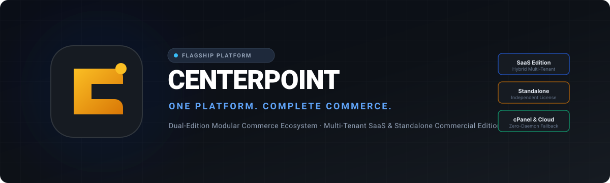
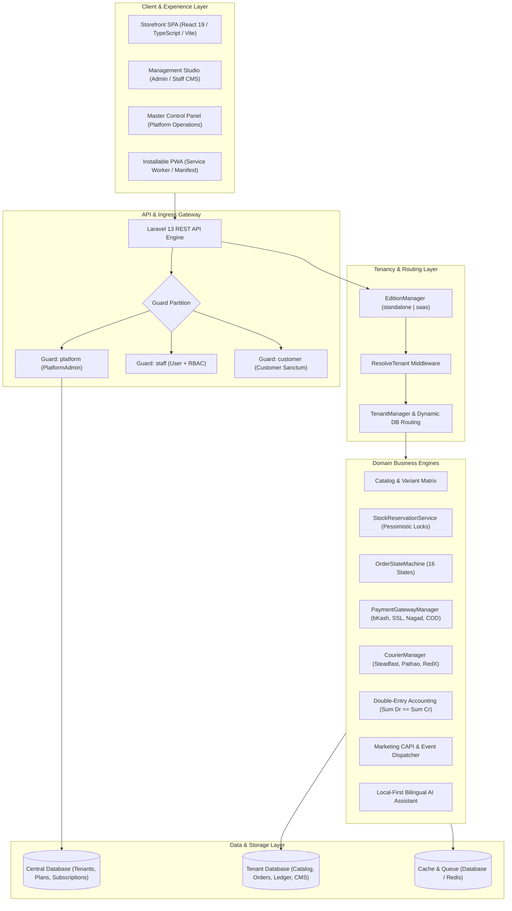
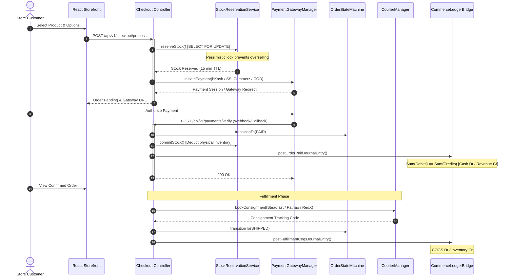

<div align="center">



<br/>

[](https://php.net)
[](https://laravel.com)
[](https://react.dev)
[](https://www.typescriptlang.org/)
[](https://gsap.com)
[](https://phpunit.de)
[](https://devcenterpoint.com)
[](LICENSE)

<br/>

**One Platform. Complete Commerce.**  
*Designed, Developed & Engineered by [DevCenterPoint](https://devcenterpoint.com)*

*CENTERPOINT is an enterprise-grade, dual-edition commerce platform that unifies curated storefronts, multi-warehouse operations, double-entry accounting, local-first intelligence, and multi-tenant SaaS capabilities into one modular ecosystem.*

<br/>

[Overview](#overview) • [Highlights](#highlights) • [UI/UX & Master Control](#ui-ux-design) • [Capabilities](#capabilities) • [Architecture](#architecture) • [Tech Stack](#tech-stack) • [Quick Start](#quick-start) • [Deployment](#deployment) • [Security](#security) • [Roadmap](#roadmap)

---

</div>

<a id="overview"></a>
## 📌 Executive Overview

Modern commerce platforms are typically trapped in a false dichotomy: businesses must either adopt an inflexible multi-tenant SaaS walled-garden with vendor lock-in, or stitch together fragile open-source plugins that lack operational rigor, accounting balance, and marketing fidelity.

**CENTERPOINT eliminates this compromise.**

Built from the ground up on a **Dual-Edition Decoupled Architecture**, CENTERPOINT serves as both:
1. **A Commercial Standalone Platform:** A self-hosted, independent commerce engine optimized for cPanel shared hosting, single VPS, or on-premise infrastructure with zero SaaS or Master Control dependencies.
2. **A Flagship Multi-Tenant SaaS Platform:** A centrally managed cloud platform with dynamic database isolation, custom domain mapping, automated tenant provisioning, subscription billing, and a Master Control Panel (MCP).

### Core Differentiators

- **Zero Mock Operations:** No simulated payments, fabricated inventory numbers, or dummy analytics. Every operational metric is calculated from real database transactions.
- **Pure Double-Entry Accounting:** Financial integrity enforced by domain invariants where every posted journal entry guarantees $\sum \text{debits} == \sum \text{credits}$ down to the exact cent.
- **Race-Condition-Proof Inventory:** Pessimistic transactional locking (`SELECT ... FOR UPDATE`) eliminates overselling during concurrent flash-sale checkouts.
- **Isolated CMS Custom Code:** Untrusted tenant JavaScript and CSS execute inside sandboxed iframes governed by strict Content Security Policies, completely neutralizing session and cookie theft vectors.
- **Local-First Bilingual AI Assistant:** Zero mandatory external API dependency. Deterministic natural language processing handles English, Bangla, and Banglish inquiries locally, with optional encrypted LLM integration.
- **Deterministic Server-Side Marketing Attribution:** Browser-server event deduplication via canonical `event_id`, SHA-256 PII hashing for Meta Conversions API (CAPI), and Google Consent Mode v2 compliance.

---

<a id="highlights"></a>
## ⚡ Key Architectural Highlights

```
┌────────────────────────────────────────────────────────────────────────┐
│                        CENTERPOINT Unified Codebase                    │
└───────────────────────────────────┬────────────────────────────────────┘
                                    │
           ┌────────────────────────┴────────────────────────┐
           ▼                                                 ▼
┌──────────────────────────────┐          ┌──────────────────────────────┐
│  CENTERPOINT Standalone      │          │  CENTERPOINT SaaS Edition    │
│  Commercial Edition          │          │  Multi-Tenant Cloud Platform │
├──────────────────────────────┤          ├──────────────────────────────┤
│ • Single Business / Single DB│          │ • Central Platform Database  │
│ • Zero SaaS Dependencies     │          │ • Dedicated Tenant Databases │
│ • cPanel / Shared Hosting OK │          │ • Master Control Panel (MCP) │
│ • Database Queue & DB Cache  │          │ • Automated Tenant Lifecycle │
│ • Complete Management Studio │          │ • Dynamic Host Resolution    │
│ • Full Storefront & CMS      │          │ • Redis Queues & Horizon     │
└──────────────────────────────┘          └──────────────────────────────┘
```

- **Dual-Edition Decoupling:** SaaS tenancy is an optional deployment driver, never hardcoded into core commerce domain models.
- **cPanel Operating Profile:** Built-in support for shared hosting constraints, including a queue worker cron fallback (`queue:work --stop-when-empty`), database-backed queues, and database cache.
- **Three-Tier Auth Partitioning:** Dedicated, isolated authentication guards for Platform Admins (`platform`), Tenant Staff (`staff`), and Store Customers (`customer`).
- **Immutable Financial & Stock Ledgers:** Physical inventory and financial journal entries are append-only. Corrections require explicit compensating reversals.

---

<a id="ui-ux-design"></a>
## 💎 Luxury Visual Architecture & Omnipotent Master Control Panel

Engineered by **[DevCenterPoint](https://devcenterpoint.com)**, CENTERPOINT features an editorial luxury aesthetic designed to completely eliminate generic "AI-sloppy" commerce templates.

### 🎨 Visual Identity & Kinetic Physics
- **Obsidian Liquid Gold & Alabaster Palette:** Deep canvas obsidian (`#09090B`) and zinc surfaces illuminated by champagne gold (`#D97706` / `#F59E0B`). Light Mode is default, styled with warm alabaster (`#FAFAF9`), pure glass cards, and crisp typography.
- **Circular Spatial Theme Reveal:** Switching themes triggers a smooth circular `clip-path` expansion starting dynamically from the exact screen coordinates of the clicked toggle button via the native View Transitions API.
- **5 Selectable Motion Profiles (Lenis + GSAP 3):**
  1. `editorial_flow` (Default): Subtle, high-velocity inertia with delicate fade-up and magnetic buttons.
  2. `cinematic_showcase`: Interactive 3D perspective tilt, mouse-tracking spotlights, and multi-layer parallax depth.
  3. `minimal_precision`: Zero parallax, ultra-snappy 120ms transitions, clean micro-damping.
  4. `velvet_luxury`: Slow graceful liquid easing, delayed stagger, deep blur shifts.
  5. `kinetic_dynamic`: Spring physics, playful hover attraction, scale popovers.
- **Bespoke Luxury Preloader:** Geometric monogram SVG draw animation with real numerical counter (0–100%) and velvet dissolve.
- **Bangladeshi Taka & Multi-Currency Engine:** Default BDT currency format (`৳ 250,000.00`) with instant header currency switching (`৳ BDT`, `$ USD`, `€ EUR`).

### 🎛️ Omnipotent Master Control Panel (MCP)
Located at the secret high-security portal (`/#mcp-login` / `/platform/control-center`), restricted exclusively to the Superadmin (`platform` guard):
- **Live Theme Customizer:** Real-time overrides for primary/accent colors, font scales, border radiuses, and glass blur intensities.
- **Dynamic CMS Section Composer:** Live editing of hero slides, marquee tickers, storytelling banners, and CTA links.
- **Currency & Gateway Levers:** Live exchange rate management and one-click toggles for bKash, SSLCommerz, Nagad, Cash on Delivery, Steadfast Courier, and Pathao Logistics.
- **Sandboxed Custom Code:** Injects custom tenant CSS/JS safely inside isolated iframes with strict CSP.
- **Branding Control:** Toggle DevCenterPoint attribution, custom logos, and platform slogans.
- **Live Telemetry & Instant Reset:** Real-time monitoring of database query latency, cache hit health, and a one-click "Reset to Factory Defaults" failsafe.

---

<a id="capabilities"></a>
## 🛠️ Platform Capabilities

### 🛍️ Commerce & Catalog Engine
- **Curated Storefront:** Editorial aesthetics powered by React 19, Tailwind CSS v4, and smooth Framer Motion micro-interactions.
- **Variant Matrix & Options:** Hierarchical product model supporting SKUs, variants, attributes (size, color, material), and tiered B2B pricing.
- **Deterministic Order State Machine:** 16 strictly validated lifecycle states (`pending`, `payment_pending`, `paid`, `processing`, `shipped`, `delivered`, `refunded`, etc.) with transition authorization rules.
- **Frozen Line-Item Snapshots:** Order items freeze unit price, tax, discount, product name, and SKU at checkout, shielding historical orders from retroactive catalog alterations.

### 📦 Inventory & Multi-Warehouse Ledger
- **Immutable Movement Ledger:** Every inventory increment or decrement is recorded as an immutable `StockMovement` categorized by transaction type (`PURCHASE_RECEIPT`, `SALE_FULFILLMENT`, `RETURN_RESTOCK`, `ADJUSTMENT`).
- **Pessimistic Reservation Locks:** Stock reservations execute within atomic database transactions with row-level locks, eliminating overselling race conditions.
- **Warehouse & Supplier Workflows:** Multi-location stock allocation, purchase orders, and supplier relationship management.

### 💳 Payment & Courier Abstraction Layer
- **Universal Payment Gateway Contract:** Pluggable adapter architecture eliminating insecure simulated callbacks.
  - **Bangladesh Adapters:** bKash Direct Checkout, SSLCommerz Hosted/Popup, Nagad Merchant API, Cash on Delivery (COD), and Storefront Customer Wallet.
  - **Idempotent Webhooks:** Transaction verification via cryptographic signatures and replay protection keys.
- **Multi-Courier Fulfillment Engine:** Automated consignment generation, parcel dimension calculation, and tracking code assignment.
  - **Supported Couriers:** Steadfast Courier API, Pathao Courier Merchant API, RedX Delivery API, and Self-Managed Fleet dispatching.

### 📊 Double-Entry Accounting Engine
- **Standard Chart of Accounts:** 16 pre-configured operational accounts spanning Assets, Liabilities, Equity, Revenue, Cost of Goods Sold (COGS), and Operating Expenses.
- **Automated Commerce Ledger Bridge:** Automatic double-entry journal postings on:
  - Order Payment: `Dr. Cash / Digital Gateway` $\rightarrow$ `Cr. Sales Revenue` & `Cr. Sales Tax Payable`
  - Fulfillment: `Dr. Cost of Goods Sold` $\rightarrow$ `Cr. Merchandise Inventory`
  - Customer Refund: `Dr. Sales Returns` $\rightarrow$ `Cr. Cash / Customer Refund Payable`
- **Real-Time Financial Statements:** Balance Sheet, Profit & Loss (P&L), and Trial Balance generated directly from balanced journal lines.

### 🎨 Storefront CMS & Visual Page Builder
- **Section Builder:** Modular JSON-driven layouts featuring Editorial Heroes, Featured Collections, Product Carousels, FAQ accordions, and Markdown blocks.
- **Sandboxed Embed Security:** Tenant-supplied custom HTML, CSS, and JavaScript execute inside an isolated `<iframe sandbox="allow-scripts allow-forms">` omitting `allow-same-origin` to isolate cookies and session tokens.
- **Strict Content Security Policy (CSP):** Isolated rendering endpoints enforce `default-src 'none'; script-src 'unsafe-inline' https:; style-src 'unsafe-inline' https:;` to eliminate cross-site scripting vulnerabilities.
- **Dynamic Theme Tokens:** Configurable brand colors, typography scales, border radii, and visual density.

### 🌐 SaaS Master Control Panel (MCP)
- **Multi-Tenant Operations:** Centralized dashboard displaying Platform Gross Merchandise Value (GMV), Monthly Recurring Revenue (MRR), Annual Recurring Revenue (ARR), and tenant churn metrics.
- **Automated Provisioning:** One-click tenant database configuration, domain routing assignment, and trial subscription initialization.
- **Live Health Runtime Probes:** Replaced static health checks with real runtime probes measuring Database Read/Write Latency, Cache Latency, Local Disk Storage I/O, and Outbound Mail Socket availability.

### 🤖 Local-First Intelligent Assistant
- **Bilingual NLP Engine:** Deterministic rule-based intent classification handling queries in English, Bangla, and Banglish without external API costs or latency.
- **Catalog & Store Knowledge Retrieval:** Local retrieval for product searches, stock availability, store policies, order tracking, and authorized merchant analytics.
- **Privacy-Preserving Optional LLMs:** Encrypted storage of tenant-supplied external API keys (OpenAI / Google Gemini) for advanced synthesis.

### 📈 Marketing, Attribution & CAPI Engine
- **Canonical Event Dispatcher:** Dispatches standard commerce events (`PageView`, `ViewContent`, `AddToCart`, `BeginCheckout`, `Purchase`).
- **Meta Conversions API (CAPI):** Server-side event transmission with client-server deduplication via unique `event_id` and SHA-256 PII hashing (`em`, `ph`, `ct`, `zp`).
- **Google Consent Mode v2 & GA4:** Strict consent validation prior to tag firing and first-party UTM/Click identifier (`gclid`, `fbclid`) attribution logging.
- **Google Merchant Center XML Feed:** Automated RSS 2.0 XML product feed generation for Google Shopping integration.

### 🔍 Dynamic SEO & Progressive Web Applications
- **Authoritative Crawl Endpoints:** Dynamic, database-driven `/sitemap.xml` and `/robots.txt` reflecting live products, categories, pages, and blog posts.
- **Schema.org Rich Snippets:** Automated JSON-LD generation for `Product` (currency, offers, availability, brand) and `BreadcrumbList`.
- **Dual Installable PWA:** Production web app manifest (`manifest.json`) and stale-while-revalidate offline Service Worker (`sw.js`).

---

<a id="architecture"></a>
## 📐 Platform Architecture

### High-Level System Architecture



### Complete Commerce & Ledger Lifecycle



---

<a id="tech-stack"></a>
## 💻 Technology Stack

| Layer | Technology | Version | Purpose |
|---|---|---|---|
| **Backend Core** | PHP | `^8.3` | High-performance server-side runtime |
| **Framework** | Laravel | `^13.8` | RESTful API, Eloquent ORM, Sanctum, Queue Workers |
| **Authentication** | Laravel Sanctum | `^4.0` | Multi-guard token authentication (`platform`, `staff`, `customer`) |
| **Database Engine** | MySQL / SQLite | `8.0+` / `3.x` | Relational storage (Central and Tenant partitioned) |
| **Frontend Core** | React | `^19.2.8` | Component-driven Single Page Application |
| **Language** | TypeScript | `~6.0.2` | End-to-end static type safety |
| **Asset Bundler** | Vite | `^8.2.0` | Lightning-fast HMR and optimized production bundling |
| **Styling & Theme** | Tailwind CSS | `^4.3.3` | Modern utility-first responsive styling and CSS variables |
| **Motion & Micro-UX** | Framer Motion | `^12.43.0` | Smooth UI animations and modal transitions |
| **Server State** | TanStack React Query | `^5.101.4` | Asynchronous data fetching, caching, and background refetching |
| **Forms & Validation** | React Hook Form + Zod | `^7.84` / `^4.6` | Schema-driven form validation and error handling |
| **Test Suite** | PHPUnit | `^12.5.12` | Automated feature, unit, and security regression testing |

---

## 🖼️ Product Showcase

Authentic screenshots and interface captures are cataloged in the [Screenshot Specification & Asset Registry](file:///d:/E-commerce-PointOne/docs/screenshots/README.md).

```
┌────────────────────────────────────────────────────────────────────────┐
│                        CENTERPOINT Interface Suite                     │
├───────────────────────────────────┬────────────────────────────────────┤
│ 01. Storefront Experience         │ 05. Product & Variant Matrix       │
│     Curated editorial catalogue,  │     Live SKU stock tracking, price │
│     drawer cart & instant search. │     tiers, and attribute options.  │
├───────────────────────────────────┼────────────────────────────────────┤
│ 02. Management Studio CMS         │ 06. Double-Entry Accounting        │
│     Role-gated operational suite, │     Automated journal postings,    │
│     drag-and-drop page builder.   │     Trial Balance & P&L statements.│
├───────────────────────────────────┼────────────────────────────────────┤
│ 03. Order Lifecycle Inspector     │ 07. SaaS Master Control Panel      │
│     16-state deterministic FSM,   │     Multi-tenant operations, MRR,  │
│     courier booking & tracking.   │     provisioning & health probes.  │
├───────────────────────────────────┼────────────────────────────────────┤
│ 04. Local-First AI Assistant      │ 08. Mobile Progressive Web App     │
│     Bilingual Bangla/English NLP  │     Standalone mobile display,     │
│     knowledge & catalog retrieval.│     offline service worker cache.  │
└───────────────────────────────────┴────────────────────────────────────┘
```

---

<a id="quick-start"></a>
## 🚀 Quick Start Guide

### Prerequisites
- **PHP**: `8.3` or higher with extensions: `pdo_mysql` (or `pdo_sqlite`), `mbstring`, `openssl`, `bcmath`, `curl`, `json`
- **Composer**: `2.x`
- **Node.js**: `18.x` or higher & `npm`

---

### 1. Clone & Backend Setup

```bash
# Clone the repository
git clone https://github.com/beingmushfiq/E-commerce-PointOne.git
cd E-commerce-PointOne/backend

# Install PHP dependencies
composer install

# Environment configuration
cp .env.example .env

# Generate application encryption key
php artisan key:generate

# Run database migrations and seed default catalog & accounts
php artisan migrate:fresh --seed

# Start Laravel development server (runs on http://127.0.0.1:8000)
php artisan serve
```

---

### 2. Frontend Setup

```bash
# In a new terminal, navigate to the frontend directory
cd E-commerce-PointOne/frontend

# Install Node dependencies
npm install

# Start Vite development server (runs on http://localhost:5173)
npm run dev
```

---

### 3. Running Automated Tests

CENTERPOINT includes an exhaustive automated test suite covering all commerce domains:

```bash
cd E-commerce-PointOne/backend
php artisan test
```

```text
Tests:    87 passed (442 assertions)
Duration: 5.53s
Result:   100% Passing (0 failures, 0 errors)
```

---

## 🔑 Demo Credentials

| Portal / Role | URL | Email / Username | Password | Permissions |
|---|---|---|---|---|
| **Storefront Customer** | `http://localhost:5173` | `customer@centerpoint.com` | `password123` | Browsing, Cart, Checkout, Order Tracking |
| **Management Studio** | `http://localhost:5173/admin` | `admin@centerpoint.com` | `password123` | Catalog, Inventory, Orders, Accounting, CMS |
| **Platform Master Control** | `http://localhost:5173/platform` | `platform@centerpoint.test` | `password123` | Multi-Tenant MCP, Provisioning, System Probes |

---

<a id="deployment"></a>
## ⚙️ Deployment Profiles

CENTERPOINT can be deployed in two official operational profiles:

### 1. Standalone Commercial Edition (cPanel & Single VPS)
- **Use Case:** Independent brands, single stores, on-premise licensing.
- **Environment Setting:** `CENTERPOINT_EDITION=standalone`
- **Queue Fallback:** Database-backed queue with periodic cron worker (`queue:work --stop-when-empty`).
- **Cache Fallback:** Database-backed cache eliminating external Redis requirement.
- **Automated Deployment:** Run `bash bin/cpanel-deploy.sh` for one-click setup.
- **Detailed Runbook:** See [cPanel Deployment Guide](file:///d:/E-commerce-PointOne/docs/deployment/cpanel-deployment-guide.md).

### 2. SaaS Multi-Tenant Cloud Edition (Cloud VPS / Docker / Kubernetes)
- **Use Case:** Multi-merchant hosted platform with subscriptions.
- **Environment Setting:** `CENTERPOINT_EDITION=saas`
- **Database Topology:** Central platform database (`central`) + isolated tenant databases (`tenant`).
- **Infrastructure:** Redis for queues, caching, and sessions with long-running Horizon workers.
- **Detailed Runbook:** See [Standalone vs. SaaS Architectural Guide](file:///d:/E-commerce-PointOne/docs/deployment/standalone-vs-saas-guide.md).

### Automated Packaging Scripts
Generate clean, distribution-ready release packages (excluding development artifacts and embedding pre-compiled frontend assets):
- **Linux/macOS:** `bash bin/package-release.sh [standalone|saas] [version]`
- **Windows PowerShell:** `.\bin\package-release.ps1 -Edition standalone -Version 1.0.0`

---

## 📂 Project Structure

```
E-commerce-PointOne/
├── backend/                             # Laravel 13 Core Application Engine
│   ├── app/
│   │   ├── Domain/                      # Domain Business Engines
│   │   │   ├── Accounting/              # Double-Entry Ledger, Balance Sheet, P&L
│   │   │   ├── Ai/                      # Local Bilingual NLP Classifier & Retriever
│   │   │   ├── Commerce/                # Stock Reservation, Order State Machine
│   │   │   ├── Fulfillment/             # Courier Adapters (Steadfast, Pathao, RedX)
│   │   │   ├── Marketing/               # Meta CAPI, Event Dispatcher, Product Feeds
│   │   │   ├── Payments/                # Gateway Adapters (bKash, SSL, Nagad, COD)
│   │   │   └── Seo/                     # Sitemap & Schema.org JSON-LD Generators
│   │   ├── Edition/                     # Dual-Edition Decoupling Manager
│   │   ├── Http/Controllers/Api/V1/    # REST API Controllers & Master Control
│   │   ├── Http/Middleware/             # Multi-Guard RBAC & Tenant Resolution
│   │   ├── Models/                      # Eloquent Domain Models & Ledgers
│   │   └── Tenancy/                     # Dynamic Host Resolution & Connection Switcher
│   ├── database/migrations/             # Central & Tenant Database Schema
│   ├── routes/                          # API (`routes/api.php`) & Web Endpoints
│   └── tests/Feature/                   # 87 Automated Feature Test Suites
├── frontend/                            # React 19 Single Page Application
│   ├── public/                          # PWA Manifest (`manifest.json`) & `sw.js`
│   ├── src/
│   │   ├── components/                  # UI Components, SandboxedEmbed & SectionRenderer
│   │   ├── services/                    # API Clients & TanStack Query Hooks
│   │   └── types/                       # Shared TypeScript Interfaces
├── bin/                                 # Operational Deployment & Packaging Scripts
│   ├── cpanel-deploy.sh                 # cPanel Automated Deployment Automation
│   ├── package-release.sh               # Cross-Platform Bash Release Packager
│   └── package-release.ps1              # Windows PowerShell Release Packager
└── docs/                                # Enterprise Documentation Knowledge Base
    ├── architecture/                    # Blueprints, Audits & Mermaid Schemas
    ├── decisions/                       # Architecture Decision Records (ADR-001 - 007)
    ├── deployment/                      # cPanel & Standalone/SaaS Deployment Guides
    └── screenshots/                     # Product Showcase Capture Specifications
```

---

<a id="security"></a>
## 🛡️ Security & Operational Integrity

All 6 primary architectural vulnerabilities identified during repository discovery have been resolved and verified with automated test suites:

| Vulnerability ID | Domain | Vulnerability Description | Resolution & Architectural Defense | Test Verification |
|:---:|---|---|---|:---:|
| **SEC-01** | Authorization | Broken access control; staff accessing admin routes | Partitioned auth guards (`platform`, `staff`, `customer`) + Spatie RBAC middleware | `AdminDashboardTest.php` |
| **SEC-02** | Payments | Insecure simulated client payment confirmation | `PaymentGatewayManager` enforcing strict gateway contracts and exception throwing | `PaymentGatewayTest.php` |
| **SEC-03** | Multi-Tenancy | Cross-tenant data leakage via query params | Hybrid DB routing via `ResolveTenant` middleware; zero trust on client headers | `TenantIsolationTest.php` |
| **SEC-04** | CMS Security | Arbitrary tenant JavaScript execution in admin origin | Sandboxed iframe rendering omitting `allow-same-origin` + strict CSP | `CmsPageBuilderTest.php` |
| **SEC-05** | Inventory | Stock overselling race conditions during concurrency | `StockReservationService` with transactional pessimistic locking (`SELECT FOR UPDATE`) | `StockReservationTest.php` |
| **SEC-06** | System Health | Hardcoded mock health diagnostics in dashboard | Live runtime probes measuring real DB latency, cache read/write, disk I/O, mail | `PlatformMasterControlTest.php` |

---

<a id="roadmap"></a>
## 🗺️ Engineering Roadmap

The CENTERPOINT development cycle has completed all 10 planned phases:

- [x] **Phase 0: Discovery, Architecture Audit & ADRs** — Complete repository inspection, threat modeling, and 7 ADRs.
- [x] **Phase 1: Dual-Edition Decoupling & Hybrid Tenancy** — Built `EditionManager`, dynamic database switching, and RBAC (SEC-01).
- [x] **Phase 2: Core Commerce Engine & Stock Reservation** — Pessimistic locking (SEC-05), 16-state FSM, and snapshotting.
- [x] **Phase 3: Payment & Delivery Abstraction Layer** — Real bKash, SSLCommerz, Nagad, Steadfast, and Pathao adapters (SEC-02).
- [x] **Phase 4: Double-Entry Accounting Engine** — Balanced journal invariant ($\sum \text{debits} == \sum \text{credits}$), P&L, Balance Sheet.
- [x] **Phase 5: Storefront CMS & Visual Page Builder** — Sandboxed iframe embedding with strict CSP (SEC-04) and theme tokens.
- [x] **Phase 6: SaaS Master Control Panel** — Dynamic runtime probes (SEC-06), tenant lifecycle, and MRR analytics.
- [x] **Phase 7: Local-First AI Assistant** — Bilingual Bangla/English catalog intent handling with zero external API dependencies.
- [x] **Phase 8: Digital Marketing & CAPI Engine** — Client-server event dedup (`event_id`), Meta CAPI SHA-256 hashing, GA4 consent mode.
- [x] **Phase 9: Dynamic SEO & Progressive Web Apps** — Live `/sitemap.xml`, `/robots.txt`, Schema.org Product JSON-LD, offline PWA.
- [x] **Phase 10: Production Hardening & Release Packaging** — cPanel deployment automation, cross-tenant leak verification, release packagers.

### Future Horizons (Post-v1.0)
- [ ] Multi-region active-active database replication.
- [ ] Offline-first mobile Point of Sale (POS) hardware integration.
- [ ] Automated TikTok Shop & WhatsApp Commerce catalog synchronizer.

---

## 🤝 Contributing

We welcome contributions from the commerce and open-source community!

1. **Fork the repository** on GitHub.
2. **Create a feature branch**: `git checkout -b feature/amazing-feature`
3. **Ensure all tests pass**:
   ```bash
   cd backend && php artisan test
   cd ../frontend && npm run build
   ```
4. **Adhere to coding standards**: Follow PSR-12 for PHP backend code and ESLint/TypeScript guidelines for frontend code.
5. **Commit your changes**: `git commit -m 'feat: add amazing feature'`
6. **Push to the branch**: `git push origin feature/amazing-feature`
7. **Open a Pull Request**.

---

## 📄 License & Project Details

This project is open-source software licensed under the **[MIT License](LICENSE)**.

- **Repository:** [https://github.com/beingmushfiq/E-commerce-PointOne](https://github.com/beingmushfiq/E-commerce-PointOne)
- **Primary Market:** Bangladesh & Global Retail / Wholesale Commerce
- **Architecture:** Modular Multi-Tenant SaaS + Standalone Commercial Edition
- **Designed & Engineered by:** [DevCenterPoint](https://devcenterpoint.com)

<div align="center">
  <br/>
  <p>© 2026 <b>CENTERPOINT</b>. Designed, Developed & Engineered by <a href="https://devcenterpoint.com"><b>DevCenterPoint</b></a>. Built with architectural rigor, kinetic poise, and dedication to modern luxury commerce.</p>
</div>
