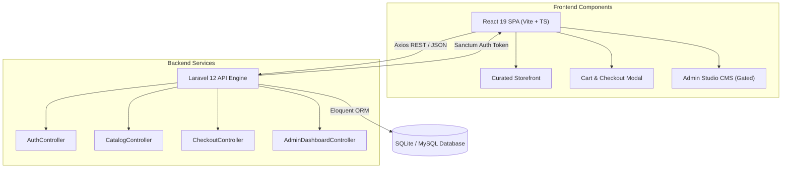

<div align="center">

# 💎 CENTERPOINT

### *Curated Luxury Storefront & Enterprise CMS*

[](https://laravel.com)
[](https://react.dev)
[](https://www.typescriptlang.org/)
[](https://vitejs.dev/)
[](https://tailwindcss.com)

<p align="center">
  A state-of-the-art bespoke e-commerce platform built with Laravel 12 Sanctum REST API and React 19 SPA, featuring editorial typography, protected Admin Studio CMS, 26 seeded luxury catalog products, and full cart/checkout workflows.
</p>

[Key Features](#-key-features) • [Tech Stack](#-technology-stack) • [Quick Start](#-quick-start-guide) • [Architecture](#-system-architecture) • [API Routes](#-api-documentation)

---

</div>

## 🌟 Key Features

### 🛍️ Luxury Storefront & Editorial UX
- **Editorial Design System**: Crafted with custom color palettes, Google Fonts (*Plus Jakarta Sans*, *Playfair Display*), smooth framer-motion micro-interactions, and crisp light aesthetics.
- **26 Seeded Products**: Populated across 4 core departments (*Fashion & Apparel*, *Home & Living*, *Tech & Audio*, *Personal Care*) complete with high-res Unsplash imagery, detailed specs, prices, and inventory stock.
- **⌘K Command Palette**: Global quick search modal allowing users to filter products and execute actions instantly.

### 🛡️ Protected Admin Studio CMS
- **Gated Authentication**: Admin Studio access is protected behind Sanctum token authentication (`admin@centerpoint.com` / `password123`) with role-based access control (RBAC).
- **Tabbed Management Suite**:
  - 📦 **Products Inventory**: Live stock level tracking, SKU search, pricing adjustments, and details inspector.
  - 📁 **Categories**: Department structure and slug routing.
  - 🎠 **CMS & Sliders**: Homepage hero sliders, store FAQs, and blog post content management.
  - 📊 **Analytics**: Real-time revenue metrics, order counts, and Average Order Value (AOV).
  - ⚙️ **Settings**: Workspace configuration and system health diagnostics.

### 🛒 Complete Cart & Checkout Workflow
- **Interactive Cart Drawer**: Side drawer displaying itemized products, quantities, subtotal, and free delivery thresholds.
- **Streamlined Checkout Modal**: Full shipping address collection, payment method selection, and instant order creation via `/v1/checkout/process`.
- **Order Confirmation**: Clean success modal rendering confirmed order details and Order ID.

### 🎯 SEO & GEO Ready
- **SEO Metadata**: Standard meta tags (`description`, `keywords`, `author`, `robots`).
- **Social Graph**: OpenGraph (`og:title`, `og:image`, `og:description`) & Twitter Card tags.
- **GEO Location Tags**: Geotargeted coordinates (`US-CA`, San Francisco) and `Schema.org/OnlineStore` JSON-LD structured data.

---

## 🛠️ Technology Stack

| Layer | Technology | Purpose |
| :--- | :--- | :--- |
| **Backend Framework** | Laravel 12 | RESTful API, ORM, Sanctum Auth, Migrations & Seeders |
| **Database** | SQLite / MySQL | Relational data store for Catalog, Orders, CMS & Users |
| **Frontend Framework**| React 19 (TypeScript) | Fast client-side SPA rendering & component modularity |
| **Build Tool** | Vite 6 | Lightning-fast HMR and production asset bundler |
| **State & Fetching** | React Query (TanStack v5) | Server state management, caching, and background refetching |
| **Styling & Motion** | Tailwind CSS + Framer Motion | Bespoke editorial layout, glassmorphism, and animations |

---

## 🚀 Quick Start Guide

### Prerequisites
- **PHP**: `>= 8.2`
- **Composer**: `>= 2.x`
- **Node.js**: `>= 18.x` & `npm`

---

### 1. Backend Setup (Laravel)

```bash
# Navigate to backend directory
cd backend

# Install PHP dependencies
composer install

# Environment setup
cp .env.example .env

# Generate application key
php artisan key:generate

# Run migrations & seed 26 products + admin user
php artisan migrate:fresh --seed

# Start Laravel development server (runs on http://localhost:8000)
php artisan serve
```

---

### 2. Frontend Setup (React SPA)

```bash
# Open a new terminal and navigate to frontend directory
cd frontend

# Install Node dependencies
npm install

# Start Vite dev server (runs on http://localhost:5173)
npm run dev
```

---

## 🔑 Demo Credentials

| Role | Email | Password | Access Rights |
| :--- | :--- | :--- | :--- |
| **Administrator** | `admin@centerpoint.com` | `password123` | Full Admin Studio CMS, Product Management, Analytics |
| **Customer** | `customer@centerpoint.com` | `password123` | Storefront Shopping, Customer Profile, Cart & Checkout |

---

## 📐 System Architecture



---

## 📜 API Documentation

### Public Endpoints
- `GET /api/v1/products` - List products with department filtering & search
- `GET /api/v1/categories` - Department category tree
- `GET /api/v1/cart` - Retrieve shopping cart items
- `POST /api/v1/cart/add` - Add item to shopping cart
- `POST /api/v1/checkout/process` - Complete checkout and place order
- `POST /api/v1/auth/login` - Authenticate user & receive Sanctum token

### Protected Admin Endpoints (`auth:sanctum`)
- `GET /api/v1/auth/me` - Fetch authenticated user profile & permissions
- `GET /api/v1/admin/analytics` - Gross revenue, KPI metrics & sales data
- `GET /api/v1/admin/health` - Server environment & health status

---

<div align="center">
  <p>Built with precision & passion for modern luxury e-commerce experience.</p>
  <p>© 2026 <b>CENTERPOINT</b>. All rights reserved.</p>
</div>
