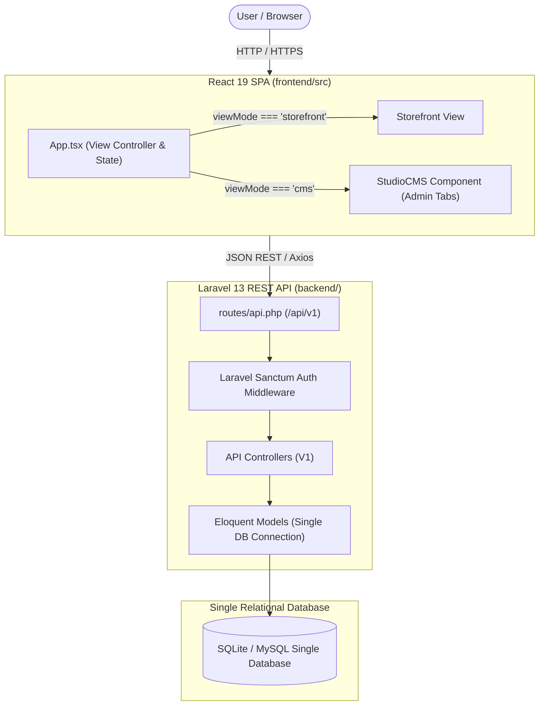
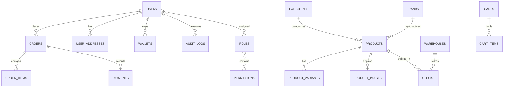

# Current Architecture Snapshot

## 1. High-Level Topology

Currently, the system is designed as a single monolithic application partitioned into a Laravel 13 backend and a React 19 single-page application (SPA).

---

## 2. Component Boundaries & Interactions

### 2.1 Monolithic Single-Page Frontend Architecture
- **State Management:** Local React state (`useState`) handles view navigation, modals, category filters, and form values. `@tanstack/react-query` manages remote server state and caching for catalog, cart, and CMS items.
- **View Toggle:** `App.tsx` conditionally returns either the storefront layout or `StudioCMS.tsx`. There is no isolated bundle or distinct application shell for the administrative workspace.
- **Styling Architecture:** Tailwind CSS v4 is bundled via `@tailwindcss/vite` using modern CSS directives (`@theme`).

### 2.2 Backend Request Lifecycle
1. Incoming HTTP requests hit `backend/public/index.php`.
2. Laravel HTTP Kernel runs standard middleware.
3. Requests matching `/api/v1/*` are routed via `routes/api.php`.
4. Protected routes verify identity via `auth:sanctum`.
5. Controllers execute queries directly on Eloquent models referencing the primary database connection (`default`).
6. Responses return JSON envelopes formatted as `{ status: 'success'|'error', data: ... }`.

---

## 3. Data Model & Entity Relations (Current)

---

## 4. Current Limitations & Architectural Deficits

1. **No Tenancy Abstraction:** Every table assumes single-tenant ownership. There is no concept of a tenant identifier, tenant context, or central database.
2. **Co-mingled Identity:** Customers and administrators reside in the same `users` table and share the same Sanctum authentication driver without guard isolation.
3. **Absence of Domain Layer:** Business logic is embedded directly within controllers and minimal service classes rather than decoupled domain actions and state machines.
4. **Vulnerable State Transitions:** Order statuses and inventory quantities can be mutated without transactional consistency or transition guards.

