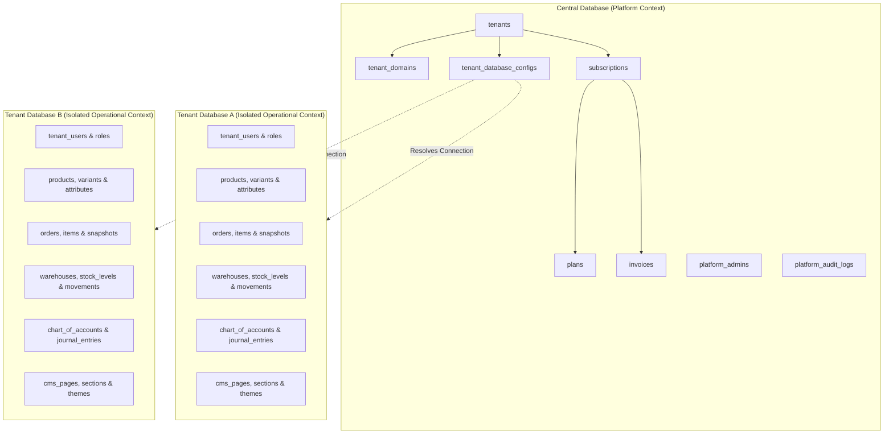

# Database Architecture — Hybrid Multi-Tenant & Standalone Topology

## 1. Hybrid Storage Strategy

CENTERPOINT adopts a hybrid multi-tenant database topology to achieve enterprise-grade isolation, compliance, and predictable performance.



---

## 2. Central Database Schema Specification

### 2.1 Tenants & Domain Routing
```sql
CREATE TABLE tenants (
    id VARCHAR(36) PRIMARY KEY, -- UUID/ULID
    name VARCHAR(255) NOT NULL,
    slug VARCHAR(100) UNIQUE NOT NULL,
    status ENUM('pending', 'active', 'suspended', 'archived') DEFAULT 'pending',
    edition ENUM('saas', 'enterprise') DEFAULT 'saas',
    created_at TIMESTAMP NULL,
    updated_at TIMESTAMP NULL
);

CREATE TABLE tenant_domains (
    id BIGINT UNSIGNED AUTO_INCREMENT PRIMARY KEY,
    tenant_id VARCHAR(36) NOT NULL,
    domain VARCHAR(255) UNIQUE NOT NULL,
    is_primary BOOLEAN DEFAULT FALSE,
    is_verified BOOLEAN DEFAULT FALSE,
    verified_at TIMESTAMP NULL,
    created_at TIMESTAMP NULL,
    updated_at TIMESTAMP NULL,
    FOREIGN KEY (tenant_id) REFERENCES tenants(id) ON DELETE CASCADE
);

CREATE TABLE tenant_database_configs (
    id BIGINT UNSIGNED AUTO_INCREMENT PRIMARY KEY,
    tenant_id VARCHAR(36) UNIQUE NOT NULL,
    driver VARCHAR(50) DEFAULT 'mysql',
    host VARCHAR(255) NOT NULL,
    port INT DEFAULT 3306,
    database_name VARCHAR(100) NOT NULL,
    username VARCHAR(100) NOT NULL,
    encrypted_password TEXT NOT NULL,
    created_at TIMESTAMP NULL,
    updated_at TIMESTAMP NULL,
    FOREIGN KEY (tenant_id) REFERENCES tenants(id) ON DELETE CASCADE
);
```

### 2.2 Subscription Engine & Platform Administration
```sql
CREATE TABLE plans (
    id BIGINT UNSIGNED AUTO_INCREMENT PRIMARY KEY,
    name VARCHAR(100) NOT NULL,
    slug VARCHAR(100) UNIQUE NOT NULL,
    price DECIMAL(12, 2) NOT NULL,
    billing_period ENUM('monthly', 'yearly') DEFAULT 'monthly',
    features_json JSON NOT NULL,
    limits_json JSON NOT NULL,
    is_active BOOLEAN DEFAULT TRUE,
    created_at TIMESTAMP NULL,
    updated_at TIMESTAMP NULL
);

CREATE TABLE subscriptions (
    id BIGINT UNSIGNED AUTO_INCREMENT PRIMARY KEY,
    tenant_id VARCHAR(36) NOT NULL,
    plan_id BIGINT UNSIGNED NOT NULL,
    status ENUM('trialing', 'active', 'past_due', 'canceled') DEFAULT 'trialing',
    trial_ends_at TIMESTAMP NULL,
    current_period_start TIMESTAMP NULL,
    current_period_end TIMESTAMP NULL,
    canceled_at TIMESTAMP NULL,
    created_at TIMESTAMP NULL,
    updated_at TIMESTAMP NULL,
    FOREIGN KEY (tenant_id) REFERENCES tenants(id) ON DELETE CASCADE,
    FOREIGN KEY (plan_id) REFERENCES plans(id)
);

CREATE TABLE platform_admins (
    id BIGINT UNSIGNED AUTO_INCREMENT PRIMARY KEY,
    name VARCHAR(255) NOT NULL,
    email VARCHAR(255) UNIQUE NOT NULL,
    password VARCHAR(255) NOT NULL,
    two_factor_secret TEXT NULL,
    is_active BOOLEAN DEFAULT TRUE,
    created_at TIMESTAMP NULL,
    updated_at TIMESTAMP NULL
);
```

---

## 3. Tenant Database Schema Specification

### 3.1 Advanced Catalog & Product Matrix
```sql
CREATE TABLE products (
    id BIGINT UNSIGNED AUTO_INCREMENT PRIMARY KEY,
    uuid VARCHAR(36) UNIQUE NOT NULL,
    name VARCHAR(255) NOT NULL,
    slug VARCHAR(255) UNIQUE NOT NULL,
    type ENUM('simple', 'variable', 'digital', 'bundle', 'service') DEFAULT 'simple',
    sku VARCHAR(100) UNIQUE NOT NULL,
    barcode VARCHAR(100) NULL,
    summary TEXT NULL,
    description LONGTEXT NULL,
    price DECIMAL(12, 2) NOT NULL,
    sale_price DECIMAL(12, 2) NULL,
    cost_price DECIMAL(12, 2) NULL,
    tax_class_id BIGINT UNSIGNED NULL,
    status ENUM('draft', 'published', 'archived') DEFAULT 'draft',
    is_featured BOOLEAN DEFAULT FALSE,
    published_at TIMESTAMP NULL,
    created_at TIMESTAMP NULL,
    updated_at TIMESTAMP NULL
);

CREATE TABLE product_variants (
    id BIGINT UNSIGNED AUTO_INCREMENT PRIMARY KEY,
    product_id BIGINT UNSIGNED NOT NULL,
    sku VARCHAR(100) UNIQUE NOT NULL,
    barcode VARCHAR(100) NULL,
    price DECIMAL(12, 2) NOT NULL,
    cost_price DECIMAL(12, 2) NULL,
    weight DECIMAL(8, 2) NULL,
    attributes_json JSON NOT NULL, -- e.g. {"color": "Onyx", "size": "XL"}
    created_at TIMESTAMP NULL,
    updated_at TIMESTAMP NULL,
    FOREIGN KEY (product_id) REFERENCES products(id) ON DELETE CASCADE
);
```

### 3.2 Inventory Movement Ledger & Warehousing
```sql
CREATE TABLE warehouses (
    id BIGINT UNSIGNED AUTO_INCREMENT PRIMARY KEY,
    code VARCHAR(50) UNIQUE NOT NULL,
    name VARCHAR(150) NOT NULL,
    address TEXT NULL,
    city VARCHAR(100) NULL,
    is_active BOOLEAN DEFAULT TRUE,
    created_at TIMESTAMP NULL,
    updated_at TIMESTAMP NULL
);

CREATE TABLE stock_levels (
    id BIGINT UNSIGNED AUTO_INCREMENT PRIMARY KEY,
    product_id BIGINT UNSIGNED NOT NULL,
    product_variant_id BIGINT UNSIGNED NULL,
    warehouse_id BIGINT UNSIGNED NOT NULL,
    quantity_on_hand INT NOT NULL DEFAULT 0,
    quantity_reserved INT NOT NULL DEFAULT 0,
    quantity_available INT GENERATED ALWAYS AS (quantity_on_hand - quantity_reserved) VIRTUAL,
    reorder_threshold INT DEFAULT 5,
    created_at TIMESTAMP NULL,
    updated_at TIMESTAMP NULL,
    UNIQUE KEY uk_variant_warehouse (product_id, product_variant_id, warehouse_id),
    FOREIGN KEY (product_id) REFERENCES products(id) ON DELETE CASCADE,
    FOREIGN KEY (product_variant_id) REFERENCES product_variants(id) ON DELETE CASCADE,
    FOREIGN KEY (warehouse_id) REFERENCES warehouses(id) ON DELETE CASCADE
);

CREATE TABLE stock_movements (
    id BIGINT UNSIGNED AUTO_INCREMENT PRIMARY KEY,
    product_id BIGINT UNSIGNED NOT NULL,
    product_variant_id BIGINT UNSIGNED NULL,
    warehouse_id BIGINT UNSIGNED NOT NULL,
    movement_type ENUM('purchase_receipt', 'sale', 'adjustment', 'transfer_in', 'transfer_out', 'return', 'reservation_release') NOT NULL,
    quantity INT NOT NULL,
    unit_cost DECIMAL(12, 2) NOT NULL,
    reference_type VARCHAR(100) NOT NULL, -- e.g. 'order', 'purchase_order', 'audit'
    reference_id VARCHAR(100) NOT NULL,
    actor_id BIGINT UNSIGNED NULL,
    notes TEXT NULL,
    created_at TIMESTAMP DEFAULT CURRENT_TIMESTAMP,
    FOREIGN KEY (product_id) REFERENCES products(id),
    FOREIGN KEY (warehouse_id) REFERENCES warehouses(id)
);
```

### 3.3 Double-Entry Accounting Schema
```sql
CREATE TABLE chart_of_accounts (
    id BIGINT UNSIGNED AUTO_INCREMENT PRIMARY KEY,
    code VARCHAR(50) UNIQUE NOT NULL, -- e.g. '1110', '4100'
    name VARCHAR(150) NOT NULL,
    type ENUM('asset', 'liability', 'equity', 'revenue', 'expense') NOT NULL,
    is_reconciliation BOOLEAN DEFAULT FALSE,
    is_active BOOLEAN DEFAULT TRUE,
    created_at TIMESTAMP NULL,
    updated_at TIMESTAMP NULL
);

CREATE TABLE journal_entries (
    id BIGINT UNSIGNED AUTO_INCREMENT PRIMARY KEY,
    entry_number VARCHAR(100) UNIQUE NOT NULL,
    entry_date DATE NOT NULL,
    reference_type VARCHAR(100) NULL, -- 'order', 'refund', 'purchase', 'payout'
    reference_id VARCHAR(100) NULL,
    description TEXT NOT NULL,
    status ENUM('draft', 'posted') DEFAULT 'draft',
    is_reversal BOOLEAN DEFAULT FALSE,
    reversal_of_id BIGINT UNSIGNED NULL,
    created_by BIGINT UNSIGNED NULL,
    posted_at TIMESTAMP NULL,
    created_at TIMESTAMP NULL,
    updated_at TIMESTAMP NULL,
    FOREIGN KEY (reversal_of_id) REFERENCES journal_entries(id)
);

CREATE TABLE journal_entry_lines (
    id BIGINT UNSIGNED AUTO_INCREMENT PRIMARY KEY,
    journal_entry_id BIGINT UNSIGNED NOT NULL,
    account_id BIGINT UNSIGNED NOT NULL,
    debit DECIMAL(14, 2) NOT NULL DEFAULT 0.00,
    credit DECIMAL(14, 2) NOT NULL DEFAULT 0.00,
    memo VARCHAR(255) NULL,
    FOREIGN KEY (journal_entry_id) REFERENCES journal_entries(id) ON DELETE CASCADE,
    FOREIGN KEY (account_id) REFERENCES chart_of_accounts(id),
    CHECK ((debit > 0 AND credit = 0) OR (credit > 0 AND debit = 0))
);
```

---

## 4. Concurrency & Transactional Invariants

1. **Pessimistic Locking on Checkout:**
   ```sql
   SELECT quantity_on_hand, quantity_reserved FROM stock_levels 
   WHERE product_id = :p AND warehouse_id = :w 
   FOR UPDATE;
   ```
2. **Double-Entry Balance Verification Check:**
   Every posted entry must satisfy:
   $$\sum \text{debits} - \sum \text{credits} = 0.00$$
3. **Database Driver Compatibility:**
   - Production targets MySQL 8.0+.
   - Local automated unit tests run against SQLite with transactional compatibility fallbacks.

