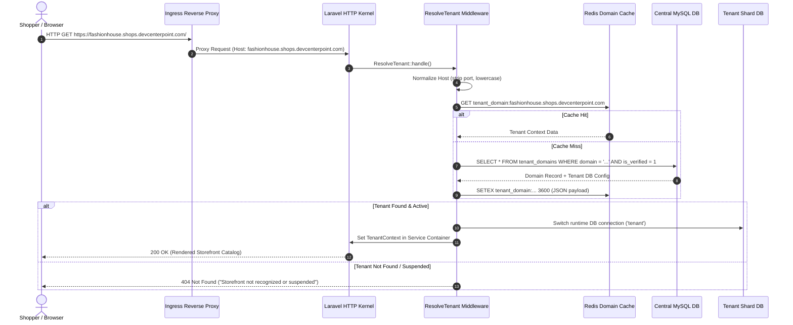

# CENTERPOINT — Domain, Ingress & Multi-Tenancy Architecture Blueprint

## 1. Executive Summary & Brand Positioning

CENTERPOINT is architected to operate under the canonical domain **`devcenterpoint.com`**. This positioning cleanly establishes **DevCenterPoint** as the parent engineering organization while elevating **CENTERPOINT** as the flagship dual-edition enterprise commerce platform.

By segregating public customer shopping traffic from privileged administrative backoffices across distinct subdomain trees, the platform achieves **flawless blast-radius isolation**, simplifies SSL lifecycle management, and creates an intuitive, trustworthy user experience for global and Bangladesh retail/wholesale markets.

---

## 2. Global Domain Hierarchy Map

```mermaid
flowchart TD
    DCP["devcenterpoint.com (Apex Domain)"]
    
    subgraph Core Platform ["Core Platform (centerpoint.devcenterpoint.com)"]
        CP_MAIN["centerpoint.devcenterpoint.com<br/>• Marketing, Features & Overview<br/>• Pricing, Comparisons & Registration"]
        CP_STUDIO["studio.centerpoint.devcenterpoint.com<br/>• Merchant Workspace & Backoffice<br/>• Inventory, Accounting & Visual CMS"]
        CP_CONTROL["control.centerpoint.devcenterpoint.com<br/>• Master Control Panel (SaaS Superadmin)<br/>• Fleet Provisioning & Tenant DB Shards"]
        CP_API["api.centerpoint.devcenterpoint.com<br/>• Central REST API Engine (Laravel 13)<br/>• Webhooks, CAPI & Mobile Gateway"]
        CP_DOCS["docs.centerpoint.devcenterpoint.com<br/>• Documentation & Developer Specs"]
        CP_STATUS["status.centerpoint.devcenterpoint.com<br/>• Uptime & Cluster Health Telemetry"]
        CP_STAGING["staging.centerpoint.devcenterpoint.com<br/>• Pre-production Staging Cluster"]
    end

    subgraph Tenant Tree ["Tenant Storefronts (*.shops.devcenterpoint.com)"]
        SHOPS_WILDCARD["*.shops.devcenterpoint.com<br/>(Wildcard DNS + Wildcard SSL)"]
        STORE_1["fashionhouse.shops.devcenterpoint.com"]
        STORE_2["techmart.shops.devcenterpoint.com"]
        STORE_3["slicemart.shops.devcenterpoint.com"]
        STORE_N["{tenant}.shops.devcenterpoint.com"]
    end

    subgraph Custom Domains ["Branded Custom Domains"]
        CUSTOM_DOM["www.fashionhouse.com<br/>(CNAME to custom.shops.devcenterpoint.com)"]
    end

    DCP --> Core Platform
    DCP --> Tenant Tree
    CUSTOM_DOM -.->|"CNAME Alias"| SHOPS_WILDCARD
```

---

## 3. Tiered Role & Boundary Specification

| Hostname | Audience / Guard | Target Application | TLS / SSL Strategy | Cookie Scope |
| :--- | :--- | :--- | :--- | :--- |
| **`centerpoint.devcenterpoint.com`** | Public Visitors & Leads | Marketing Landing Page, Plans & Signup | Dedicated SAN Certificate | Host-only |
| **`{store}.shops.devcenterpoint.com`** | Store Shoppers (`customer`) | Branded Storefront, Catalog, Cart, Checkout | Wildcard `*.shops.devcenterpoint.com` | Scoped to `{store}.shops...` |
| **`studio.centerpoint.devcenterpoint.com`** | Store Staff (`staff`) | Merchant Operating Studio & Visual Page CMS | Dedicated SAN Certificate | Host-only |
| **`control.centerpoint.devcenterpoint.com`** | Platform Superadmins (`platform`) | SaaS Operator Console & Infrastructure Manager | Dedicated SAN Certificate + IP Allowlist | Host-only |
| **`api.centerpoint.devcenterpoint.com`** | Headless Clients & SPAs | Core Laravel 13 REST Engine | Dedicated SAN Certificate | Stateless Bearer / Session |
| **`docs.centerpoint.devcenterpoint.com`** | Developers & Merchants | Documentation & Knowledge Base | Dedicated SAN Certificate | Host-only |
| **`status.centerpoint.devcenterpoint.com`** | Public & Stakeholders | System Uptime & Incident Telemetry | Dedicated SAN Certificate | Host-only |
| **`staging.centerpoint.devcenterpoint.com`** | QA & DevOps | Staging Cluster (Dual-Edition Mirror) | Dedicated SAN Certificate | Host-only |
| **`{custom-domain.com}`** | Store Shoppers (`customer`) | Branded Custom Domain Storefront | Automated Let's Encrypt / Cloudflare | Custom Host-only |

---

## 4. Key Architectural & Security Advantages

### A. Strict Cookie & Cross-Site Scripting (XSS) Boundary
In e-commerce SaaS platforms, merchants are permitted to insert custom banners, tracking pixels (Meta CAPI, TikTok, Google Analytics), and rich embed widgets.
- If tenant storefronts shared a parent domain with `studio.` (e.g. `{store}.devcenterpoint.com`), malicious or compromised third-party scripts could access cookies scoped to `.devcenterpoint.com`.
- By placing all customer storefronts on **`*.shops.devcenterpoint.com`**, modern browsers strictly prevent scripts running on `fashionhouse.shops.devcenterpoint.com` from accessing `studio.centerpoint.devcenterpoint.com` or `control.centerpoint.devcenterpoint.com`.

### B. Scalable Wildcard SSL Lifecycle
- Provisioning individual SSL certificates for thousands of free or trial tenants introduces certificate authority rate-limit bottlenecks and DNS propagation delays.
- A single **Wildcard SSL Certificate** (`*.shops.devcenterpoint.com`) instantly secures every new tenant storefront upon database provisioning with zero seconds of delay.
- Dedicated certificates are maintained exclusively for the core infrastructure domains (`centerpoint.`, `studio.`, `control.`, `api.`).

### C. Privileged Ingress Protection
Because the Master Control Panel is hosted on its own dedicated hostname (**`control.centerpoint.devcenterpoint.com`**):
- It can be protected at the Cloudflare / WAF layer with zero-trust network access (ZTNA), client certificates (mTLS), or IP allowlisting without affecting merchant backoffices or customer stores.
- Rate limiting rules can be tuned independently: storefronts accept high burst traffic; control panel endpoints enforce strict brute-force throttling.

---

## 5. DNS Configuration Matrix

To deploy this architecture, the following DNS records are configured in your DNS provider (Cloudflare, cPanel, or AWS Route53):

```dns
;; Core Apex & Platform Records
centerpoint.devcenterpoint.com.      IN A      <INGRESS_LOAD_BALANCER_IP>
studio.centerpoint.devcenterpoint.com. IN A      <INGRESS_LOAD_BALANCER_IP>
control.centerpoint.devcenterpoint.com. IN A      <INGRESS_LOAD_BALANCER_IP>
api.centerpoint.devcenterpoint.com.    IN A      <INGRESS_LOAD_BALANCER_IP>
docs.centerpoint.devcenterpoint.com.   IN A      <INGRESS_LOAD_BALANCER_IP>
status.centerpoint.devcenterpoint.com. IN A      <INGRESS_LOAD_BALANCER_IP>
staging.centerpoint.devcenterpoint.com. IN A     <STAGING_SERVER_IP>

;; Multi-Tenant Storefront Wildcard Record
*.shops.devcenterpoint.com.           IN A      <INGRESS_LOAD_BALANCER_IP>

;; Custom Domain Ingress Endpoint
custom.shops.devcenterpoint.com.      IN A      <INGRESS_LOAD_BALANCER_IP>
```

---

## 6. Tenant Resolution & Anti-Spoofing Pipeline

### Lifecycle Flowchart



### Anti-Spoofing Rules
1. **Host Header Primacy:** Tenant resolution is derived solely from the HTTP `Host` header validated by Nginx/Caddy.
2. **Header Ban:** Any incoming `X-Tenant-ID`, `X-Shop-Slug`, or query parameter `?tenant_id=...` supplied by the client is discarded and ignored by authorization middleware.
3. **Reserved Slugs Blacklist:** The registration engine enforces an immutable reservation list:
   ```php
   [
       'admin', 'administrator', 'studio', 'control', 'api', 'shops', 'shop',
       'billing', 'support', 'status', 'auth', 'app', 'cdn', 'mail', 'dev',
       'staging', 'test', 'master', 'root', 'help', 'docs', 'assets'
   ]
   ```

---

## 7. Custom Domain Workflow (e.g. `www.fashionhouse.com`)

When a merchant upgrades to a tier supporting custom domains:

1. **Merchant Adds Domain in Studio:**
   - In `studio.centerpoint.devcenterpoint.com/settings/domain`, merchant inputs `www.fashionhouse.com`.
   - Studio generates a verification TXT token: `cp-verify=tnt_a891f7...`.
2. **Merchant Sets DNS Records:**
   - `TXT @ cp-verify=tnt_a891f7...` (Verifies domain ownership).
   - `CNAME www custom.shops.devcenterpoint.com` (Routes traffic to platform ingress).
3. **Platform Automated Verification:**
   - Background worker checks `dns_get_record()` for the TXT token.
   - Upon verification, sets `is_verified = true` in `central.tenant_domains`.
4. **SSL Provisioning:**
   - Cloudflare for SaaS (or Caddy / Certbot On-Demand TLS) issues the SSL certificate for `www.fashionhouse.com`.
   - Traffic now seamlessly resolves to the merchant's tenant database.

---

## 8. Frontend Routing Architecture (Single SPA Deployment)

In production, the frontend can be deployed as a single optimized Vite build where the client shell adapts automatically to the incoming hostname:

```typescript
// Subdomain Resolution Logic in frontend/src/utils/domain.ts
export type PlatformSurface = 'storefront' | 'studio' | 'control' | 'marketing';

export function detectSurfaceFromHost(hostname: string): {
  surface: PlatformSurface;
  tenantSlug: string | null;
} {
  const host = hostname.toLowerCase();

  // 1. Localhost / Dev Environment (Path-based fallback)
  if (host === 'localhost' || host === '127.0.0.1') {
    return { surface: 'storefront', tenantSlug: null };
  }

  // 2. Master Control Panel
  if (host.startsWith('control.')) {
    return { surface: 'control', tenantSlug: null };
  }

  // 3. Merchant Studio
  if (host.startsWith('studio.')) {
    return { surface: 'studio', tenantSlug: null };
  }

  // 4. Tenant Storefronts (*.shops.devcenterpoint.com)
  const shopsSuffix = '.shops.devcenterpoint.com';
  if (host.endsWith(shopsSuffix)) {
    const slug = host.replace(shopsSuffix, '');
    return { surface: 'storefront', tenantSlug: slug };
  }

  // 5. Main Marketing Landing (centerpoint.devcenterpoint.com)
  if (host === 'centerpoint.devcenterpoint.com') {
    return { surface: 'marketing', tenantSlug: null };
  }

  // 6. Custom Merchant Domains (e.g. www.fashionhouse.com)
  return { surface: 'storefront', tenantSlug: 'custom' };
}
```

This delivers an enterprise user experience where visiting:
- `control.centerpoint.devcenterpoint.com` displays the high-density Master Control Console.
- `studio.centerpoint.devcenterpoint.com` displays the Merchant Studio & Visual CMS.
- `fashionhouse.shops.devcenterpoint.com` displays Fashion House's bespoke luxury storefront.
- `localhost:5173` remains convenient for local development with path-based navigation (`/`, `/studio`, `/platform`).
