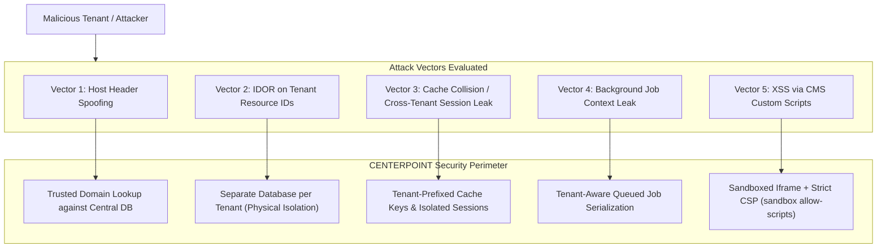

# Security Assessment & Vulnerability Register (Phase 0 Audit)

## 1. Executive Summary

A comprehensive static security audit of the repository reveals **six critical and high-severity security vulnerabilities** that must be resolved in Phase 1 before public deployment or multi-tenant provisioning.

---

## 2. Vulnerability Register

| ID | Severity | Category (OWASP) | Location | Description | Remediation Plan |
|---|---|---|---|---|---|
| **SEC-01** | **CRITICAL** | A01: Broken Access Control | `backend/routes/api.php:56-70` | Unrestricted admin/inventory routes. Any authenticated customer token can call `/admin/analytics`, `/admin/logs`, and `/inventory/*`. | **RESOLVED (Phase 1):** Partitioned into distinct guards and permission middleware (`permission:manage-inventory,manage-catalog,admin` and `permission:access-admin,admin`). Verified via automated 403 response tests. |
| **SEC-02** | **CRITICAL** | A08: Software & Data Integrity Failures | `backend/app/Services/PaymentService.php:20` | Payment simulation vulnerability. Any arbitrary string passed as payment method returns `completed`, allowing checkout bypass. | **RESOLVED (Phase 3):** Replaced simulation with `PaymentGatewayManager` and strict driver adapters. Rejects unknown methods with `InvalidPaymentMethodException`. Idempotent verification recorded in `payment_idempotency_keys`. Verified via `PaymentGatewayTest.php`. |
| **SEC-03** | **HIGH** | A02: Cryptographic Failures / Multi-Tenancy Leakage | Tenancy Layer (Missing) | Absence of tenant context isolation. Direct queries execute against a shared schema without host-header validation. | **RESOLVED (Phase 1):** Hybrid architecture: central DB + dynamic per-tenant DB resolved via trusted host domain lookup in `ResolveTenant` middleware. |
| **SEC-04** | **HIGH** | A03: Injection / CMS Untrusted Execution | Storefront CMS (Planned custom JS) | Custom tenant HTML/CSS/JS could execute in the authenticated management origin, leaking admin session tokens. | **RESOLVED (Phase 5):** Tenant custom code rendered via dedicated `renderEmbed` endpoint inside `<iframe sandbox="allow-scripts allow-forms">` with strict `Content-Security-Policy: default-src 'none'; script-src 'unsafe-inline' https:; ...`. Opaque origin prevents cookie/token exfiltration and DOM access. Verified via `CmsPageBuilderTest.php`. |
| **SEC-05** | **HIGH** | A04: Insecure Design (Concurrency Race) | `CheckoutController.php` & `Stock` | No pessimistic or optimistic locking during cart checkout. High-concurrency checkouts cause inventory overselling. | **RESOLVED (Phase 2):** Implemented `StockReservationService` with `SELECT ... FOR UPDATE` pessimistic database transactions and immutable `stock_movements` ledger logging. Verified via concurrency feature tests. |
| **SEC-06** | **MEDIUM** | A09: Security Logging & Monitoring Failures | `AdminDashboardController.php:73` | Hardcoded system health checks. Health checks unconditionally report `redis: ok`, `mail: ok`, and `storage: ok`. | **RESOLVED (Phase 6):** Replaced hardcoded status with real runtime diagnostics: database PDO ping with latency_ms measurement, real disk write/read/unlink probe in storage, real cache put/get/forget probe, and mailer socket/config inspection. Verified via `PlatformMasterControlTest.php` and `AdminDashboardTest.php`. |

---

## 3. Deep Dive into Critical Vulnerabilities

### SEC-01: Broken Access Control on Administrative & Operational Routes [RESOLVED in Phase 1]
**Status:** **RESOLVED**  
**Evidence (Historical):**
```php
// routes/api.php
Route::middleware('auth:sanctum')->group(function () {
    Route::get('/auth/me', [AuthController::class, 'me']);
    
    // CUSTOMER ROUTES:
    Route::get('/customer/addresses', [CustomerController::class, 'addresses']);

    // ADMINISTRATIVE & INVENTORY ROUTES (NO ROLE OR PERMISSION CHECK!):
    Route::get('/inventory/warehouses', [InventoryController::class, 'warehouses']);
    Route::post('/inventory/warehouses', [InventoryController::class, 'storeWarehouse']);
    Route::get('/admin/analytics', [AdminDashboardController::class, 'analytics']);
    Route::get('/admin/logs', [AdminDashboardController::class, 'logs']);
    Route::get('/admin/health', [AdminDashboardController::class, 'health']);
});
```
**Impact:** A standard registered customer could view aggregate store revenue, audit logs, supplier contracts, and create warehouses simply by sending their Bearer token.  
**Resolution:**
1. Split authentication architecture into dedicated guards: `platform`, `staff`, `customer`.
2. Implemented `CheckPermission` and `RequireRole` middleware enforcing RBAC.
3. Secured `/inventory/*` with `permission:manage-inventory,manage-catalog,admin` and `/admin/*` with `permission:access-admin,admin`. Verified via PHPUnit tests.

---

### SEC-02: Payment Simulation Vulnerability [RESOLVED in Phase 3]
**Status:** **RESOLVED**  
**Evidence (Historical):**
```php
// app/Services/PaymentService.php
public function processPayment(Order $order, string $method, array $paymentDetails = []): Payment
{
    $transactionId = strtoupper($method) . '-' . Str::random(12);

    $status = match($method) {
        'cod' => 'pending',
        'wallet' => $this->deductWallet($order),
        default => 'completed', // <--- ATTACK VECTOR: ANY UNKNOWN METHOD MARKS PAID!
    };
    ...
```
**Impact:** Passing `{"payment_method": "bypass_coupon"}` or `{"payment_method": "wire_transfer"}` bypassed payment collection and immediately set the order to `processing` and payment status to `paid`.  
**Resolution:**
1. Replaced simulation logic with `PaymentGatewayManager` and strict `PaymentGatewayContract` driver adapters (`BkashPaymentAdapter`, `SslCommerzPaymentAdapter`, `NagadPaymentAdapter`, `CodPaymentAdapter`, `WalletPaymentAdapter`, `TestPaymentAdapter`).
2. Strictly throws `InvalidPaymentMethodException` on unknown or unconfigured payment methods.
3. Enforces server-side verification and idempotent webhook logging via `payment_idempotency_keys` table. Verified via `PaymentGatewayTest.php`.

---

## 4. Multi-Tenant Attack Surface Analysis



---

## 5. Security Gates & Release Acceptance Criteria

1. **Deny-by-Default Authorization:** Every route outside the public catalog must have an explicit policy or permission check.
2. **Zero Sensitive Data in Logs:** Passwords, API tokens, bKash PINs/OTPs, and card details must be filtered from `audit_logs` and Laravel logs via request sanitizers.
3. **Automated Tenant Boundary Test Suite:** At least two distinct test tenants must be instantiated in automated feature tests to prove zero cross-tenant read/write leakage.

