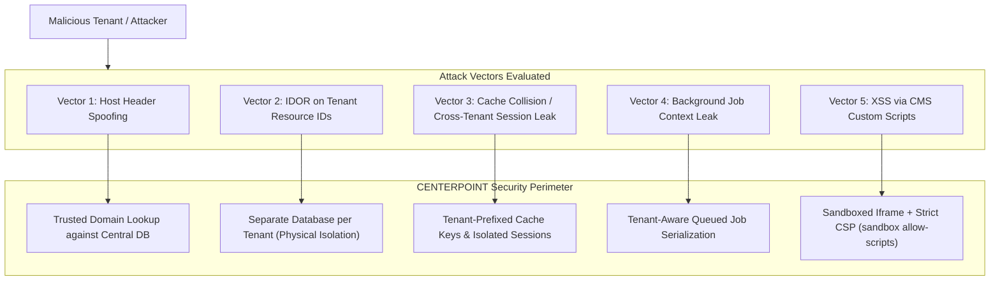

# Security Assessment & Vulnerability Register (Phase 0 Audit)

## 1. Executive Summary

A comprehensive static security audit of the repository reveals **six critical and high-severity security vulnerabilities** that must be resolved in Phase 1 before public deployment or multi-tenant provisioning.

---

## 2. Vulnerability Register

| ID | Severity | Category (OWASP) | Location | Description | Remediation Plan |
|---|---|---|---|---|---|
| **SEC-01** | **CRITICAL** | A01: Broken Access Control | `backend/routes/api.php:56-70` | Unrestricted admin/inventory routes. Any authenticated customer token can call `/admin/analytics`, `/admin/logs`, and `/inventory/*`. | **RESOLVED (Phase 1):** Partitioned into distinct guards and permission middleware (`permission:manage-inventory,manage-catalog,admin` and `permission:access-admin,admin`). Verified via automated 403 response tests. |
| **SEC-02** | **CRITICAL** | A08: Software & Data Integrity Failures | `backend/app/Services/PaymentService.php:20` | Payment simulation vulnerability. Any arbitrary string passed as payment method returns `completed`, allowing checkout bypass. | Strip simulation defaults. Every payment method must invoke an authorized adapter with server-side validation. |
| **SEC-03** | **HIGH** | A02: Cryptographic Failures / Multi-Tenancy Leakage | Tenancy Layer (Missing) | Absence of tenant context isolation. Direct queries execute against a shared schema without host-header validation. | Implement dynamic tenant database connections resolved via trusted central domain mapping. |
| **SEC-04** | **HIGH** | A03: Injection / CMS Untrusted Execution | Storefront CMS (Planned custom JS) | Custom tenant HTML/CSS/JS could execute in the authenticated management origin, leaking admin session tokens. | Render all tenant-supplied custom code within an isolated sandboxed `iframe` with a restrictive Content Security Policy (`CSP`). |
| **SEC-05** | **HIGH** | A04: Insecure Design (Concurrency Race) | `CheckoutController.php` & `Stock` | No pessimistic or optimistic locking during cart checkout. High-concurrency checkouts cause inventory overselling. | Implement `SELECT ... FOR UPDATE` transactions within `StockReservationService`. |
| **SEC-06** | **MEDIUM** | A09: Security Logging & Monitoring Failures | `AdminDashboardController.php:73` | Hardcoded system health checks. Health checks unconditionally report `redis: ok`, `mail: ok`, and `storage: ok`. | Replace with dynamic, real runtime probe validations (ping Redis, inspect disk write, verify mailer socket). |

---

## 3. Deep Dive into Critical Vulnerabilities

### SEC-01: Broken Access Control on Administrative & Operational Routes
**Evidence:**
```php
// routes/api.php
Route::middleware('auth:sanctum')->group(function () {
    Route::get('/auth/me', [AuthController::class, 'me']);
    
    // CUSTOMER ROUTES:
    Route::get('/customer/addresses', [CustomerController::class, 'addresses']);

    // ADMINISTRATIVE & INVENTORY ROUTES (NO ROLE OR PERMISSION CHECK!):
    Route::get('/inventory/warehouses', [InventoryController::class, 'warehouses']);
    Route::post('/inventory/warehouses', [InventoryController::class, 'storeWarehouse']);
    Route::get('/admin/analytics', [AdminDashboardController::class, 'analytics']);
    Route::get('/admin/logs', [AdminDashboardController::class, 'logs']);
    Route::get('/admin/health', [AdminDashboardController::class, 'health']);
});
```
**Impact:** A standard registered customer can view aggregate store revenue, audit logs, supplier contracts, and create warehouses simply by sending their Bearer token.
**Required Fix:**
1. Split `auth:sanctum` into distinct guards: `auth:staff` and `auth:customer`.
2. Attach explicit authorization middleware: `middleware(['auth:staff', 'permission:manage-inventory'])`.

---

### SEC-02: Payment Simulation Vulnerability
**Evidence:**
```php
// app/Services/PaymentService.php
public function processPayment(Order $order, string $method, array $paymentDetails = []): Payment
{
    $transactionId = strtoupper($method) . '-' . Str::random(12);

    $status = match($method) {
        'cod' => 'pending',
        'wallet' => $this->deductWallet($order),
        default => 'completed', // <--- ATTACK VECTOR: ANY UNKNOWN METHOD MARKS PAID!
    };
    ...
```
**Impact:** Passing `{"payment_method": "bypass_coupon"}` or `{"payment_method": "wire_transfer"}` bypasses payment collection and immediately sets the order to `processing` and payment status to `paid`.
**Required Fix:**
1. Eliminate `default => 'completed'`. Unknown payment methods must throw `InvalidPaymentMethodException`.
2. Integrate provider-specific adapters with cryptographically verified callbacks.

---

## 4. Multi-Tenant Attack Surface Analysis



---

## 5. Security Gates & Release Acceptance Criteria

1. **Deny-by-Default Authorization:** Every route outside the public catalog must have an explicit policy or permission check.
2. **Zero Sensitive Data in Logs:** Passwords, API tokens, bKash PINs/OTPs, and card details must be filtered from `audit_logs` and Laravel logs via request sanitizers.
3. **Automated Tenant Boundary Test Suite:** At least two distinct test tenants must be instantiated in automated feature tests to prove zero cross-tenant read/write leakage.

