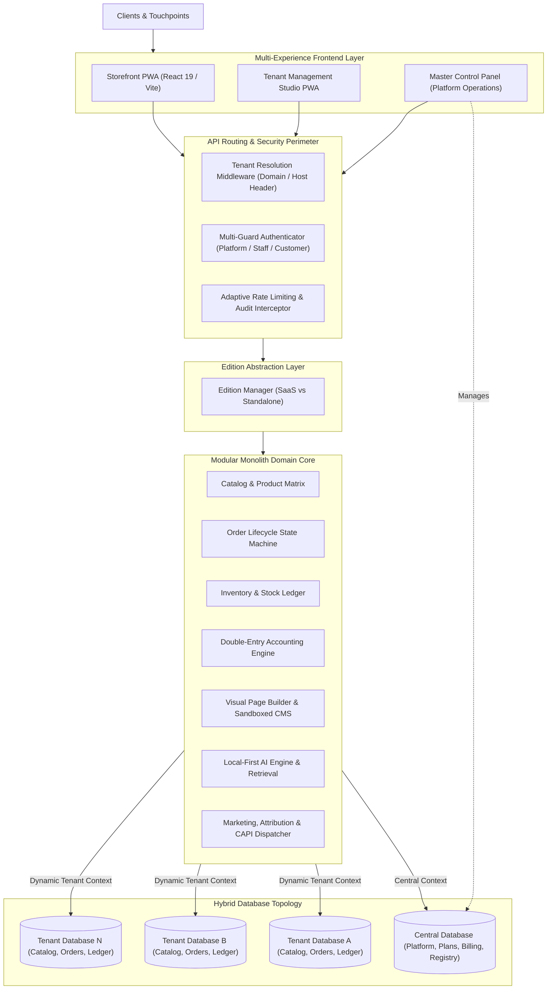
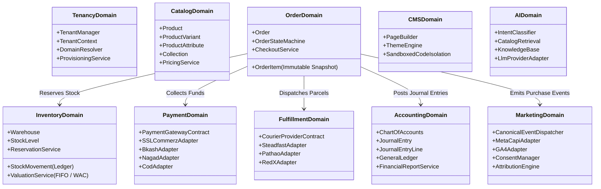

# Target Architecture — CENTERPOINT Commerce Platform

## 1. Architectural Vision & Core Paradigms

CENTERPOINT is structured as a **modular commerce engine** where SaaS tenancy is an optional deployment capability, not an inescapable dependency.

---

## 2. Dual-Edition Deployment Profiles

### 2.1 CENTERPOINT SaaS Edition
- **Target:** Hosted multi-tenant platform.
- **Topology:**
  - One **Central Database**: Manages platform administrators, tenant registry, domain mappings, subscription plans, usage meters, billing invoices, and platform audit logs.
  - Dynamic **Tenant Databases**: Each tenant operates in an isolated MySQL database containing their customers, products, orders, inventory, accounting, and CMS.
  - **Master Control Panel:** Administrative interface for platform operators.

### 2.2 CENTERPOINT Standalone Edition
- **Target:** Single-business commercial licensing (on-premise or independent cloud/cPanel hosting).
- **Topology:**
  - Single independent database containing the complete commerce engine.
  - Zero dependency on external platform controllers, remote licensing servers, or central billing.
  - Dedicated Management Studio for tenant owners.

---

## 3. Bounded Contexts & Domain Architecture

---

## 4. Key Architectural Invariants

1. **Strict Context Isolation:** Database queries, filesystem storage, cache tags, and queued jobs are explicitly scoped to the active tenant context. A job running in the queue restores the tenant's exact database connection and settings before execution.
2. **Deterministic State Transitions:** Orders, payments, stock reservations, and shipments progress exclusively through formal state machine transitions that emit domain events and maintain audit trails.
3. **Decoupled External Adapters:** All third-party providers (bKash, SSLCommerz, Steadfast, Meta CAPI, OpenAI) implement unified PHP interfaces (`*Contract`). Switching or testing providers requires zero changes to core domain logic.
4. **Sandboxed Custom Code:** Any tenant-authored JavaScript executes exclusively in an isolated `iframe` governed by restrictive Content Security Policies (`CSP`), preventing access to privileged admin tokens or customer sessions.

