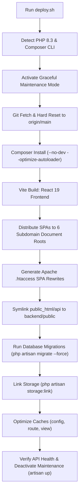

# CENTERPOINT — cPanel Production Deployment & Automation Guide
**Multi-Subdomain SaaS & Standalone Hybrid Architecture**  
**Target Domain:** `devcenterpoint.com` | **Stack:** Laravel 13 (PHP 8.3) + React 19 / Vite + MySQL 8.0

---

## 1. Architectural Summary & Operating Topology

CENTERPOINT is deployed on cPanel with high security, separating backend code from public webroots while isolating each surface into dedicated subdomains:

```
/home/{username}/
├── centerpoint/                            # Private application repository (OUTSIDE webroot)
│   ├── backend/                           # Laravel 13 API core
│   │   ├── app/
│   │   ├── config/
│   │   ├── storage/
│   │   ├── vendor/
│   │   └── artisan
│   ├── frontend/                          # React 19 + Vite SPA source
│   ├── bin/
│   │   └── cpanel-deploy.sh               # Master deployment engine
│   ├── .cpanel.yml                        # cPanel Git Version Control deployment trigger
│   ├── deploy.sh                          # Root one-click terminal wrapper
│   └── .env                               # Production environment secrets
│
└── public_html/                           # cPanel Document Root Area
    ├── api/ -> ../centerpoint/backend/public  # Backend API Ingress (api.centerpoint.devcenterpoint.com)
    ├── centerpoint/                       # Marketing & Landing SPA (centerpoint.devcenterpoint.com)
    ├── studio/                            # Merchant Studio SPA (studio.centerpoint.devcenterpoint.com)
    ├── control/                           # Master Control Panel SPA (control.centerpoint.devcenterpoint.com)
    ├── shops/                             # Wildcard Tenant Storefront SPA (*.shops.devcenterpoint.com)
    ├── docs/                              # Documentation SPA (docs.centerpoint.devcenterpoint.com)
    └── status/                            # System Status SPA (status.centerpoint.devcenterpoint.com)
```

---

## 2. Part 1: Database Architecture & Partitioning on cPanel

### 2.1 Central Platform Database
The central database stores tenant accounts, domain routing tables, platform audit logs, and global billing subscriptions.

1. Navigate to **cPanel > MySQL® Database Wizard**.
2. **Step 1 — Create Database:**
   - Database name: `{username}_cp_central` (e.g., `devcent_cp_central`).
3. **Step 2 — Create Database User:**
   - Username: `{username}_cp_master` (e.g., `devcent_cp_master`).
   - Generate a 24+ character password and store it safely.
4. **Step 3 — Assign Privileges:**
   - Select **ALL PRIVILEGES**.
   - Collation: `utf8mb4_unicode_ci` (default in MySQL 8.0).

### 2.2 Tenant Database Partitioning Strategies
On cPanel, CENTERPOINT supports two tenant isolation strategies:

#### Strategy A: Dedicated Databases per Tenant (Recommended for Enterprise / High Isolation)
- Database name pattern: `{username}_tnt_{tenant_slug}` (e.g., `devcent_tnt_fashionhouse`).
- Assign the master user `{username}_cp_master` with **ALL PRIVILEGES** to each tenant database.
- Automated creation via cPanel UAPI:
  ```bash
  uapi Mysql create_database name="{username}_tnt_${SLUG}"
  uapi Mysql set_privileges_on_database user="{username}_cp_master" database="{username}_tnt_${SLUG}" privileges="ALL PRIVILEGES"
  ```

#### Strategy B: Shared Schema with Tenant ID Partitioning (Recommended for Shared Hosting)
- Set `CPANEL_MODE=true` in `.env`.
- All operational data runs within `{username}_cp_central`, partitioned by indexed `tenant_id` foreign keys, with database-backed queue and cache enabled.

---

## 3. Part 2: Subdomain Creation & Wildcard DNS on cPanel

### 3.1 DNS Zone Configuration
Ensure your DNS records in **cPanel > Zone Editor** (or Cloudflare) have these records pointing to your server IP:

| Type | Record | Value | TTL |
| :--- | :--- | :--- | :--- |
| **A** | `centerpoint.devcenterpoint.com` | `SERVER_IP` | 14400 |
| **A** | `studio.centerpoint.devcenterpoint.com` | `SERVER_IP` | 14400 |
| **A** | `control.centerpoint.devcenterpoint.com` | `SERVER_IP` | 14400 |
| **A** | `api.centerpoint.devcenterpoint.com` | `SERVER_IP` | 14400 |
| **A** | `docs.centerpoint.devcenterpoint.com` | `SERVER_IP` | 14400 |
| **A** | `status.centerpoint.devcenterpoint.com` | `SERVER_IP` | 14400 |
| **A** | `*.shops.devcenterpoint.com` | `SERVER_IP` | 14400 |

### 3.2 Subdomain Creation in cPanel GUI
Navigate to **cPanel > Domains** (or **Subdomains**):

1. **API Ingress:**
   - Domain: `api.centerpoint.devcenterpoint.com`
   - Document Root: `public_html/api`
2. **Main Product Website:**
   - Domain: `centerpoint.devcenterpoint.com`
   - Document Root: `public_html/centerpoint`
3. **Merchant Studio:**
   - Domain: `studio.centerpoint.devcenterpoint.com`
   - Document Root: `public_html/studio`
4. **Master Control Panel:**
   - Domain: `control.centerpoint.devcenterpoint.com`
   - Document Root: `public_html/control`
5. **Documentation Portal:**
   - Domain: `docs.centerpoint.devcenterpoint.com`
   - Document Root: `public_html/docs`
6. **System Status Portal:**
   - Domain: `status.centerpoint.devcenterpoint.com`
   - Document Root: `public_html/status`
7. **Wildcard Tenant Storefronts:**
   - Domain: `*.shops.devcenterpoint.com`
   - Document Root: `public_html/shops`

### 3.3 SSL Certificate Issuance (AutoSSL / Let's Encrypt)
1. Go to **cPanel > SSL/TLS Status**.
2. Select all subdomains (`centerpoint`, `studio`, `control`, `api`, `docs`, `status`, and `*.shops.devcenterpoint.com`).
3. Click **Run AutoSSL**. AutoSSL will provision DV certificates.
> [!NOTE]
> If using Cloudflare for DNS, keep SSL mode set to **Full (Strict)** and install an Origin Certificate on cPanel to cover `devcenterpoint.com` and `*.devcenterpoint.com`, `*.shops.devcenterpoint.com`.

---

## 4. Part 3: cPanel Git Version Control & Automated Deployment

### 4.1 Set Up Deployment Key in cPanel
1. Open **cPanel > Terminal** (or SSH).
2. Generate an SSH key for deployment:
   ```bash
   ssh-keygen -t ed25519 -C "deploy@devcenterpoint.com" -f ~/.ssh/id_ed25519_deploy -N ""
   cat ~/.ssh/id_ed25519_deploy.pub
   ```
3. Copy the public key and add it as a **Deploy Key** (Read-Only) in your GitHub / GitLab repository settings.

### 4.2 Initialize Git Repository in cPanel GUI
1. Navigate to **cPanel > Git™ Version Control**.
2. Click **Create**:
   - **Clone Repository:** Enabled
   - **Clone URL:** `git@github.com:your-org/E-commerce-PointOne.git`
   - **Repository Path:** `centerpoint` (this clones into `/home/{username}/centerpoint`)
   - **Repository Name:** `CENTERPOINT`
3. Click **Create**. cPanel clones the codebase.

### 4.3 Automated `.cpanel.yml` Hook
The repository includes a `.cpanel.yml` file in the root:

```yaml
---
deployment:
  tasks:
    - export DEPLOYPATH=/home/$(whoami)/centerpoint
    - /bin/bash $DEPLOYPATH/bin/cpanel-deploy.sh --cpanel-git
```

Whenever you push to `main` (via cPanel Git webhook) or click **Update from Remote > Deploy HEAD Commit** in cPanel, cPanel automatically executes `bin/cpanel-deploy.sh`!

---

## 5. Part 4: One-Click Terminal Deployment Script

You can deploy or update the entire platform with a single command in the **cPanel Terminal**:

```bash
cd ~/centerpoint
bash deploy.sh
```

### 5.1 Deployment Flags & Options
| Command | Action |
| :--- | :--- |
| `bash deploy.sh` | **Full Production Deploy:** Maintenance mode, git sync, composer install, frontend build, multi-subdomain asset distribution, migrations, cache, health checks. |
| `bash deploy.sh --quick` | **Quick Deploy:** Skips heavy Composer update and asset rebuild; runs migrations, clears/optimizes cache, and reloads. |
| `bash deploy.sh --skip-build` | **Backend-Only Deploy:** Pulls git changes, installs composer packages, runs migrations, and rebuilds caches. |
| `bash deploy.sh --fresh` | **Fresh Seed Deploy:** (Staging only) Runs `migrate:fresh --seed` with sample catalog data. |

### 5.2 What the Deployment Script Executes Automatically


---

## 6. Part 5: Production `.env` Configuration File

Create `/home/{username}/centerpoint/.env` (or in `/home/{username}/centerpoint/backend/.env`):

```ini
APP_NAME=CENTERPOINT
APP_ENV=production
APP_KEY=base64:GENERATE_WITH_ARTISAN_KEY_GENERATE
APP_DEBUG=false
APP_URL=https://api.centerpoint.devcenterpoint.com

# Multi-Tenant & Domain Routing
CENTERPOINT_EDITION=saas
CENTERPOINT_DOMAIN_SUFFIX=shops.devcenterpoint.com
CENTERPOINT_MARKETING_URL=https://centerpoint.devcenterpoint.com
CENTERPOINT_STUDIO_URL=https://studio.centerpoint.devcenterpoint.com
CENTERPOINT_CONTROL_URL=https://control.centerpoint.devcenterpoint.com
CENTERPOINT_API_URL=https://api.centerpoint.devcenterpoint.com
CENTERPOINT_DOCS_URL=https://docs.centerpoint.devcenterpoint.com
CENTERPOINT_STATUS_URL=https://status.centerpoint.devcenterpoint.com

# cPanel Operational Profile (Resilient & Daemonless)
CPANEL_MODE=true
CPANEL_FORCE_DB_QUEUE=true
CPANEL_FORCE_DB_CACHE=true

# Database Credentials
DB_CONNECTION=mysql
DB_HOST=127.0.0.1
DB_PORT=3306
DB_DATABASE=devcent_cp_central
DB_USERNAME=devcent_cp_master
DB_PASSWORD=YOUR_STRONG_DATABASE_PASSWORD

# Cache, Queue & Session (Database Fallback)
CACHE_STORE=database
QUEUE_CONNECTION=database
SESSION_DRIVER=database
SESSION_LIFETIME=120

# Storage Driver
FILESYSTEM_DISK=public

# Mail Configuration (cPanel Exim SMTP)
MAIL_MAILER=smtp
MAIL_HOST=mail.devcenterpoint.com
MAIL_PORT=465
MAIL_USERNAME=noreply@devcenterpoint.com
MAIL_PASSWORD=YOUR_EMAIL_ACCOUNT_PASSWORD
MAIL_ENCRYPTION=ssl
MAIL_FROM_ADDRESS="noreply@devcenterpoint.com"
MAIL_FROM_NAME="CENTERPOINT Platform"
```

---

## 7. Part 6: cPanel Cron Configuration

Shared cPanel hosting does not support continuous background processes (`supervisord` / `php artisan horizon`). CENTERPOINT handles background processing via cPanel scheduled cron jobs:

Navigate to **cPanel > Cron Jobs**:

### Cron 1: Laravel Task Scheduler (Every Minute)
Runs scheduled reports, inventory reconciliation, and recurring billing:
```bash
* * * * * /usr/local/bin/ea-php83 /home/{username}/centerpoint/backend/artisan schedule:run >> /dev/null 2>&1
```

### Cron 2: Queue Worker (Every 2 Minutes)
Processes emails, webhooks, invoice generation, and audit logging asynchronously:
```bash
*/2 * * * * /usr/local/bin/ea-php83 /home/{username}/centerpoint/backend/artisan queue:work --stop-when-empty --tries=3 --timeout=90 >> /dev/null 2>&1
```

---

## 8. Verification & Post-Deployment Checklist

After running `bash deploy.sh`, verify all endpoints:

1. **Backend API Health:**
   ```bash
   curl -I https://api.centerpoint.devcenterpoint.com/api/v1/health
   # Expected: HTTP/2 200 OK
   ```
2. **Main Product Website:**
   Open `https://centerpoint.devcenterpoint.com` in your browser. Verify the luxury hero banner and onboarding registration.
3. **Merchant Studio:**
   Open `https://studio.centerpoint.devcenterpoint.com`. Test login using seeded tenant credentials:
   - Email: `merchant@centerpoint.atelier`
   - Password: `password123`
4. **Master Control Panel:**
   Open `https://control.centerpoint.devcenterpoint.com`. Test superadmin login:
   - Email: `superadmin@centerpoint.com`
   - Password: `password123`
5. **Wildcard Tenant Storefront:**
   Open `https://fashionhouse.shops.devcenterpoint.com` or `https://techmart.shops.devcenterpoint.com`. Verify the tenant catalog renders dynamically.
